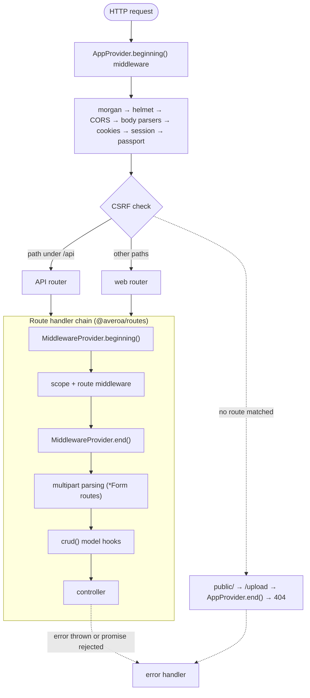

<p align="center">
  
</p>

<h1 align="center">AveroaJS</h1>

<p align="center">
  A Laravel-style application structure for Express 5: controllers, models, migrations, generators and secure defaults.
</p>

<p align="center">
  <a href="#license"></a>
  =24">
  
  
</p>

---

AveroaJS is an application boilerplate for REST APIs and server-rendered sites built on **Express 5**, **Knex 3**,
**Objection 3** and **Edge 5**. This repository is the application you clone and build on. The framework code lives
in three npm packages ([`@averoa/core`](#ecosystem), [`@averoa/routes`](#ecosystem) and
[`@averoa/utilities`](#ecosystem)) that the application installs as ordinary dependencies.

> [!NOTE]
> Version 2 is **ESM only** and requires **Node.js 20.19 or newer** on 20.x, 22.13 or newer on 22.x, or 24 and newer. If you are
> coming from 1.x, read [Upgrading from 1.x](#upgrading-from-1x) first; for the changes in 2.1.0, see
> [What's new in 2.1.0](#whats-new-in-210).

## Table of contents

- [Overview](#overview)
- [Features](#features)
- [Requirements](#requirements)
- [Quick start](#quick-start)
- [Project structure](#project-structure)
- [Architecture](#architecture)
- [Configuration](#configuration)
- [Routing](#routing)
- [Controllers, middleware and providers](#controllers-middleware-and-providers)
- [Models](#models)
- [CRUD and query filters](#crud-and-query-filters)
- [Authentication](#authentication)
- [Views](#views)
- [Mail, queues and jobs](#mail-queues-and-jobs)
- [File uploads](#file-uploads)
- [Database: migrations and seeds](#database-migrations-and-seeds)
- [CLI generators](#cli-generators)
- [Utilities](#utilities)
- [Security](#security)
- [Docker and deployment](#docker-and-deployment)
- [Testing and linting](#testing-and-linting)
- [Upgrading from 1.x](#upgrading-from-1x)
- [Ecosystem](#ecosystem)
- [Troubleshooting](#troubleshooting)
- [Contributing](#contributing)
- [License](#license)

## Overview

AveroaJS gives an Express application the folder layout and conventions of a Laravel project. Routes point at
`'Controller@method'` strings, models describe their own columns once for migrations, seeders and validation, and
`router.crud()` together with the `Crud` helper turns a model into a validated, filterable, paginated REST resource.

It is intended for developers who want Express's simplicity and ecosystem but prefer a predictable project
structure over assembling middleware by hand for every new service.

**Design principles**

- **Convention over configuration.** Controllers, middleware, models and providers are found by name in fixed
  folders under `app/`. Routing, views, sessions and error handling are wired by `@averoa/core` at startup.
- **Laravel-style layout.** `app/Controllers`, `app/Models`, `app/Middleware`, `app/Providers`, `routes/`,
  `resources/views`, `database/migrations` and `database/seeds` mean what they mean in Laravel.
- **Secure by default.** Helmet with a Content Security Policy, CSRF protection, `httpOnly` session cookies, a CORS
  policy that fails closed outside development, request size limits, sandboxed upload serving and scrypt password
  hashing are on without any configuration.
- **Fail early.** A missing `TOKEN_SECRET`, a missing `SESSION_SECRET` outside development and test, or a route that points at a
  controller method that does not exist stops the application at startup rather than at request time.

## Features

| Area | What you get |
| --- | --- |
| Structure | Laravel-style folders, `#models` / `#helpers` / ... subpath imports instead of `../../` paths |
| Routing | `'Controller@method'` handlers, prefixes, groups, route and global middleware, multipart `*Form` routes, `crud()` model hooks |
| Models | Objection models whose `static column` map drives migrations, faker seeders and request validation; soft delete and audit columns; hidden columns |
| REST resources | `node averoa make:crud <tables>` generates model, migration, seeder, controller and routes |
| Query language | Thirteen filter operators, pagination, sorting, grouping, `$select`, `$relations`, all validated against the model's columns |
| Authentication | JWT login (`POST /api/auth/login`) and a passport-local session strategy, scrypt password hashing |
| Views | Edge 5 templates with dot-notation names, global variables and a CSRF token in every view |
| Mail and queues | Nodemailer with Edge templates, RabbitMQ publishing, and a mail worker with retries and reconnects |
| Database | MySQL (`mysql2`, default), PostgreSQL (`pg`) and SQLite (`better-sqlite3`, `sqlite3`) through Knex |
| Operations | Access and error logs, winston logging, graceful shutdown on `SIGTERM` / `SIGINT` |
| Testing | `node --test` integration tests that boot the real app on in-memory SQLite |

## Requirements

| Requirement | Version / notes |
| --- | --- |
| Node.js | `^20.19.0 \|\| ^22.13.0 \|\| >=24` (`engines` in `package.json`, the range declared by ESLint 10 and `@faker-js/faker` 10): 20.19 or later, 22.13 or later on the 22.x line, or 24 and newer. `npm test` runs on all of them. |
| npm | 10 or later (declared by `@faker-js/faker` 10, which the seeders use) |
| Database | One of the clients handled by `config/database.js`: `mysql2` (default, installed), `pg`, `better-sqlite3` (installed as a devDependency) or `sqlite3`. Install `pg` or `sqlite3` yourself when you use them. |
| RabbitMQ | Optional. Only needed for `Queue()`, `Mail...queue()` and the mail worker. |
| SMTP server | Optional. Only needed to send mail. |
| `@aws-sdk/client-s3` | Optional. Only needed for `UPLOAD_DRIVER=s3`; an `optionalDependency`, installed unless you pass `--omit=optional`, see [Storing uploads in S3](#storing-uploads-in-s3). |
| Docker | Optional. Docker Engine with Compose v2 for the `Dockerfile` and `compose.yaml`, see [Docker and deployment](#docker-and-deployment). |

## Quick start

The steps below use SQLite, so no database server is needed.

```bash
git clone https://github.com/budiherma1/averoajs.git
cd averoajs
npm install
cp .env.example .env
```

The application refuses to start without `TOKEN_SECRET`. Generate it and a session secret:

```bash
echo "TOKEN_SECRET=$(npm run -s generate:token)" >> .env
echo "SESSION_SECRET=$(npm run -s generate:token)" >> .env
```

Point the database at a SQLite file. A relative path is resolved against the application root, so the app and the
knex CLI open the same file:

```bash
echo "DB_CLIENT=better-sqlite3" >> .env
echo "DB_NAME=database/dev.sqlite" >> .env
```

The appended lines win over the empty values earlier in `.env`. Now create the tables, load the demo data and start
the development server (nodemon):

```bash
npm run migrate:up
npm run seed:run
npm run dev
```

Open <http://localhost:8888> for the welcome page, or call the API:

```bash
curl http://localhost:8888/api
# {"name":"Averoa","version":"2.1.0"}

curl -X POST http://localhost:8888/api/auth/login \
  -H 'content-type: application/json' \
  -d '{"email":"demo@averoa.test","password":"password"}'
# {"status":true,"data":{"token":"eyJ...","type":"Bearer","expires_in":"1h"}}
```

**Using Docker instead.** `compose.yaml` runs the app with MySQL, RabbitMQ, Redis, MinIO and Mailpit; see
[Docker and deployment](#docker-and-deployment).

**Using MySQL or PostgreSQL instead.** Leave `DB_CLIENT=mysql2` (or set `DB_CLIENT=pg` after `npm install pg`), fill in
`DB_HOST`, `DB_PORT`, `DB_USER`, `DB_PASS` and `DB_NAME`, and create the database before running the migrations.
Knex does not create the database itself.

### Routes in the boilerplate

| Method | Path | Handler | Notes |
| --- | --- | --- | --- |
| `GET` | `/` | `SampleController@sampleMethodView` | renders `welcome.edge` |
| `GET` | `/users` | `SampleController@sampleMethodModel` | renders `users.edge` with every user's first name (no emails or addresses) |
| `GET` | `/teacher` | `TeacherController@index` | renders `teacher.edge` |
| `GET` | `/api` | `SampleController@sampleMethod` | `{ name, version }` |
| `POST` | `/api/users` | `SampleController@sampleMethodModelPost` | behind `AuthMiddleware`; validates the body with `Users.validation()`; on success returns the user list (it does not insert) |
| `POST` | `/api/auth/login` | `AuthController@login` | issues a JWT |
| `GET` | `/api/auth/me` | `AuthController@me` | behind `AuthMiddleware` |
| `GET` `POST` `PUT` `DELETE` | `/api/teachers`, `/api/teachers/:id` | `TeacherController` | `router.crud('Teacher', 'teachers', ...)`; `GET` is public, `POST` / `PUT` / `DELETE` are behind `AuthMiddleware` |
| `GET` | `/api/v2/teachers` | `TeacherController@findAll` | nested `prefix()` example |
| `GET` | `/api/v2/test`, `/api/v2/test/otherprefix` | `SampleController@sampleMethodView` | nested `prefix()` example |

These routes are samples. `/api/auth/me`, `POST /api/users` and the Teacher writes require a JWT (see
[Authentication](#authentication)); the rest are public. Remove or protect them before you deploy (see
[Production checklist](#production-checklist)).

## Project structure

```text
averoajs/
├── app/
│   ├── Console/              placeholder for project commands (not wired yet)
│   ├── Controllers/          request handlers, referenced as 'NameController@method'
│   ├── Helpers/              helpers, exported from index.js          -> '#helpers'
│   ├── Jobs/                 jobs and workers                          -> '#jobs'
│   ├── Middleware/           route middleware, referenced by file name
│   ├── Models/               Objection models with column definitions  -> '#models'
│   ├── Providers/            App, Middleware, Upload and View providers -> '#providers'
│   ├── Repositories/         query classes                             -> '#repositories'
│   └── Strategies/           passport strategies                       -> '#strategies'
├── config/
│   ├── database.js           Knex configuration from DB_* variables
│   ├── fetch.js              axios defaults for the Fetch utility from FETCH_* variables
│   ├── mail.js               nodemailer transport from MAIL_* variables
│   └── queue.js              AMQP URL from RABBITMQ_SERVER
├── database/
│   ├── migrations/           Knex migrations (ESM)
│   ├── seeds/                Knex seeders, run in file-name order
│   └── stubs/                ESM templates for migrate:make and seed:make
├── public/                   static files served at /
├── resources/
│   ├── assets/               placeholder (not wired yet)
│   ├── lang/                 placeholder (not wired yet)
│   └── views/                Edge templates
├── routes/
│   ├── api.js                mounted at /api
│   ├── web.js                mounted at /
│   └── v2/                   route modules included by api.js
├── scripts/
│   ├── link-local.mjs        install local checkouts of the framework packages
│   └── run-tests.mjs         npm test: runs tests/*.test.js on every platform
├── storages/
│   ├── logs/                 averoa.log, access.log, error.log
│   └── upload/               uploaded files (UPLOAD_DRIVER=local), served at /upload
├── tests/                    node:test suites
├── workers/
│   └── mail.js               mail worker entry point: npm run worker:mail
├── .dockerignore             files kept out of the Docker build context (.env, node_modules, ...)
├── .env.example              environment template
├── averoa.js                 CLI entry point: node averoa <command>
├── compose.yaml              local development stack (app, MySQL, RabbitMQ, Redis, MinIO, Mailpit)
├── Dockerfile                production image (and a development target for compose.yaml)
├── eslint.config.js          ESLint 10 flat config
└── server.js                 application entry point: awaits start() from @averoa/core
```

## Architecture

### Bootstrap sequence

`server.js` calls `start()` from `@averoa/core`. `start()` builds the application in this order and then listens:

1. Load `.env` from the application root. Variables already present in the environment take precedence.
2. Import `@averoa/utilities`, which creates the shared Knex instance (`config/database.js`), the logger and the
   Edge instance.
3. Import `app/Providers/index.js` (optional).
4. Create the Express app, disable `x-powered-by`, and apply `TRUST_PROXY`.
5. `AppProvider.beginning(app)`.
6. Request logging (morgan) to `storages/logs/access.log` and `storages/logs/error.log`, plus the console outside
   `production` and `test`.
7. Helmet, using the options returned by `AppProvider.helmet(defaults)`.
8. CORS.
9. `express.json()` and `express.urlencoded()` limited to `BODY_LIMIT`, then `cookie-parser`.
10. `express-session` (merged with `AppProvider.session()`), `passport.initialize()` and `passport.session()`.
11. `config()` of every export of `app/Strategies/index.js`.
12. Bind Objection to the shared Knex instance.
13. Register the Edge view engine and `ViewProvider.global()`.
14. Load `routes/api.js` and `routes/web.js` and resolve every controller, middleware and model they reference.
15. CSRF protection (unless `CSRF_ENABLED=false`).
16. Mount the API router at `/api` and the web router at `/`.
17. Serve `public/` at `/` and `storages/upload` at `/upload`.
18. `AppProvider.end(app)`.
19. 404 handler and error handler.

`start()` then listens on `options.port`, `APP_PORT` or `3000` (all interfaces), calls `AppProvider.server(server)`
and installs the graceful-shutdown handlers. `createApp()` runs steps 1 to 19 without listening; the test suite uses it.

| Function | Returns | Options |
| --- | --- | --- |
| `start(options?)` | `Promise<{ app, server }>` | `port`, `host` (listen hostname), `handleSignals` (default `true`) |
| `createApp(options?)` | `Promise<{ app }>` | none needed by applications |

### Request lifecycle



The error handler answers with JSON (`{ status: false, message }`) when the path is under `/api`, the request is an
XHR, or the client prefers JSON, and with a small HTML page otherwise. Error `status` / `statusCode` values between 400
and 599 are kept; anything else becomes 500. 5xx errors are logged. When `NODE_ENV` is `development` or `test` the
response also contains the stack trace; with any other `NODE_ENV`, including unset, there is no stack and 5xx messages
are replaced by `Internal Server Error`.

### How application code is found

The framework packages never import your code with relative paths. They resolve the **application root** and import
files from there:

1. `AVEROA_ROOT`, when set (absolute, or relative to the working directory).
2. Otherwise the nearest directory, walking up from the working directory, that contains a `package.json` and is not
   inside `node_modules`.

Within the application, `package.json` defines [subpath imports](https://nodejs.org/api/packages.html#subpath-imports)
so your own modules never need `../../` paths:

| Import | Resolves to |
| --- | --- |
| `#models` | `app/Models/index.js` |
| `#providers` | `app/Providers/index.js` |
| `#repositories` | `app/Repositories/index.js` |
| `#helpers` | `app/Helpers/index.js` |
| `#jobs` | `app/Jobs/index.js` |
| `#strategies` | `app/Strategies/index.js` |
| `#app/*` | `app/*`, with the file extension, e.g. `#app/Strategies/JwtStrategy.js` |

```js
import { Users } from '#models';
import { PasswordHelper } from '#helpers';
```

Generated migrations and seeders import models through `#models`, so keep the `imports` block in `package.json`.

## Configuration

All settings come from environment variables, loaded from `.env` in the application root. Start from
`.env.example`. Defaults below are what the code uses when a variable is unset.

### Application

| Variable | Default | Description |
| --- | --- | --- |
| `NODE_ENV` | unset | `development` and `test` enable the permissive local behaviour (non-`secure` session cookie, credentialed CORS without a whitelist). Any other value, including unset, gets the production-safe behaviour: `SESSION_SECRET` is required and stack traces and 5xx details are hidden. `production` additionally enables the view cache and the CSP's `upgrade-insecure-requests`, and stops logging to the console. `.env.example` sets `development`. |
| `APP_PORT` | `3000` | Port to listen on. `.env.example` sets `8888`. |
| `APP_HOST` | `http://localhost` | Only used in the startup message. The server listens on all interfaces. |
| `TOKEN_SECRET` | none, **required** | HS256 secret for JWTs. Startup fails without it. |
| `TOKEN_EXPIRES_IN` | `1h` | JWT lifetime in jsonwebtoken format (`60`, `2h`, `7d`). |
| `SESSION_SECRET` | random per boot | Session cookie secret. **Required unless `NODE_ENV` is `development` or `test`.** A comma-separated list rotates secrets: the first signs, all verify. |
| `CSRF_ENABLED` | `true` | `false`, `0`, `no` or `off` disables CSRF protection. |
| `CORS_WHITELIST` | empty | Comma-separated allowed origins. See [CORS](#cors). Empty in `.env.example`. |
| `BODY_LIMIT` | `1mb` | Maximum JSON and urlencoded body size. Larger bodies get `413`. |
| `LOG_LEVEL` | `info` | winston level: `error`, `warn`, `info`, `http`, `verbose`, `debug`, `silly`. |
| `TRUST_PROXY` | unset | Express `trust proxy`: `true`, `false`, a hop count, or an Express trust string such as `loopback`. `.env.example` sets `false`. |
| `SHUTDOWN_TIMEOUT` | `10000` | Milliseconds allowed for graceful shutdown before the process is forced to exit. |
| `AVEROA_ROOT` | auto-detected | Application root. Only needed when the process starts outside the project folder. |

### Uploads

| Variable | Default | Description |
| --- | --- | --- |
| `UPLOAD_MAX_FILE_SIZE` | `UploadImageMiddleware`: 2 MB; `*Form` routes: 10 MB | Maximum file size in bytes for both. `.env.example` sets `2097152` (2 MB). |
| `UPLOAD_MAX_FILES` | `10` | Maximum number of files per `*Form` request. |
| `UPLOAD_INLINE_EXTENSIONS` | `jpg,jpeg,png,gif,webp,avif,bmp,ico` | Extensions served inline from `/upload` (and stored without `Content-Disposition: attachment` in S3); everything else is sent as a download. |
| `UPLOAD_DRIVER` | `local` | Where `UploadProvider` stores files: `local` (`storages/upload`) or `s3`. Any other value is an error. |
| `S3_BUCKET` | none | Bucket name. Required when `UPLOAD_DRIVER=s3`. |
| `S3_REGION` | `us-east-1` | Bucket region. |
| `S3_ENDPOINT` | unset (AWS) | Endpoint of an S3-compatible service, e.g. `http://localhost:9000` (MinIO), `https://<account>.r2.cloudflarestorage.com`. |
| `S3_FORCE_PATH_STYLE` | `false` | `true` for `endpoint/bucket/key` URLs instead of `bucket.endpoint/key`; MinIO needs it. |
| `S3_ACCESS_KEY_ID`, `S3_SECRET_ACCESS_KEY` | unset | Static credentials. Set both or neither; when unset the AWS SDK's default credential chain is used (IAM role, `AWS_*` variables, shared config). |
| `S3_PUBLIC_URL` | derived | Base URL that `UploadProvider.url()` puts in front of a key, e.g. your CDN. Defaults to the bucket's endpoint URL. |

### Database

| Variable | Default | Description |
| --- | --- | --- |
| `DB_CLIENT` | `mysql2` | `mysql2`, `pg`, `better-sqlite3` or `sqlite3`. `mysql` is mapped to `mysql2`. |
| `DB_HOST`, `DB_PORT`, `DB_USER`, `DB_PASS`, `DB_NAME` | unset | Connection settings. For SQLite clients `DB_NAME` is the database file (default `:memory:`). `.env.example` sets `127.0.0.1:3306`. |
| `AVEROA_CONFIG_WAIT_MS` | `2000` | How long `@averoa/utilities` waits for `config/database.js` at import time before continuing to load it in the background. |

### Mail and queues

| Variable | Default | Description |
| --- | --- | --- |
| `MAIL_HOST`, `MAIL_PORT` | unset | SMTP server. `.env.example` sets `127.0.0.1:2525`. |
| `MAIL_USERNAME`, `MAIL_PASSWORD` | unset | SMTP credentials. Leave `MAIL_USERNAME` empty for no authentication. |
| `MAIL_ENCRYPTION` | unset | `ssl` uses implicit TLS (port 465 does too). `tls` or empty lets nodemailer negotiate STARTTLS. |
| `MAIL_SECURE` | unset | `true` forces implicit TLS, `false` turns it off; either overrides `MAIL_ENCRYPTION` and the port. |
| `MAIL_QUEUE` | `mail` | Default queue for `Mail...queue()` and the mail worker. |
| `RABBITMQ_SERVER` | unset | AMQP URL. `Queue` throws when it is not configured. `.env.example` sets `amqp://localhost`. |

SMTP is the only mail transport.

### Fetch

| Variable | Default | Description |
| --- | --- | --- |
| `FETCH_BASE_URL` | unset | Base URL prepended to relative `Fetch` URLs. |
| `FETCH_TIMEOUT` | `10000` | Request timeout in milliseconds; `0` disables it. |

### Configuration files

| File | Used by | Contents |
| --- | --- | --- |
| `config/database.js` | `DB`, Objection, the knex CLI | Default export `(process) => knexConfig`. Maps `DB_*` to a Knex config; resolves a relative SQLite `DB_NAME` against the application root; enables `dateStrings` for `mysql2`; points `migrate:make` / `seed:make` at the ESM templates in `database/stubs`. |
| `config/mail.js` | `Mail`, the mail worker | nodemailer SMTP transport options from `MAIL_*`. Add a `queue` key to change the default mail queue. |
| `config/queue.js` | `Queue` | `{ amqp }` from `RABBITMQ_SERVER`. A `heartbeat` key (seconds, default 5) is also accepted. |
| `config/fetch.js` | `Fetch` | axios defaults: `baseURL` from `FETCH_BASE_URL`, `timeout` from `FETCH_TIMEOUT` (default 10 s), no body size limits. Commented examples show `maxContentLength`, `auth` and `proxy`. |

Each file may export an object or a function that receives `process`. Config files must not import the root
`@averoa/utilities` package (see [Troubleshooting](#troubleshooting)); import helpers from
`@averoa/utilities/paths` instead.

## Routing

`routes/api.js` is mounted at `/api` and `routes/web.js` at `/`. Each file creates a router with `Router()` from
`@averoa/routes`, declares routes, and default-exports it. Core calls `init()` at startup, which resolves every handler
and middleware and fails with an error naming the route if a file or method is missing.

```js
import Router from '@averoa/routes';

const router = Router();

router.get('/', 'SampleController@sampleMethodView');
router.get('/health', (req, res) => res.json({ ok: true }));

router.middleware(['AuthMiddleware'], () => {
  router.get('/profile', 'ProfileController@show');
});

router.group({ prefix: 'admin', middleware: ['AuthMiddleware'] }, () => {
  router.crud('Users', 'users', () => {
    router.get('/', 'UsersController@findAll');
    router.post('/', 'UsersController@create');
  });
});

export default router;
```

### Router API

| Method | Description |
| --- | --- |
| `get` `post` `put` `patch` `delete` `(uri, handler, middleware?)` | Register one verb. `handler` is `'Controller@method'` or a function. `middleware` is an array. |
| `postForm` `putForm` `patchForm` `(uri, handler, middleware?)` | Same, with multipart parsing: files in `req.files`, fields in `req.body`. |
| `match(verbs, uri, handler, middleware?)` | Several verbs: any of `get`, `post`, `put`, `patch`, `delete`, `head`, `options`, `all`. |
| `any(uri, handler, middleware?)` | `get`, `post`, `put`, `delete` and `patch`. |
| `all(uri, handler, middleware?)` | Express `router.all()`. Never receives `crud()` model hooks. |
| `middleware(names, callback)` | Apply middleware to every route declared in `callback`. |
| `prefix(prefix, callback)` | Prefix every route declared in `callback`. |
| `group({ prefix, middleware }, callback)` | Both of the above. |
| `crud(model, prefix?, callback)` | Prefix plus the model hooks described in [CRUD and query filters](#crud-and-query-filters). `set()` is an alias. |
| `config({ controller, middleware, model, upload })` | Change the folders (`{ path }`), the middleware method name (`middleware.method`, default `handle`) or the multer limits (`upload.limits`) for this router. |

Rules worth knowing:

- **Handlers.** `'TeacherController@findAll'` loads the default export of `app/Controllers/TeacherController.js`. The
  export may be an instance, a class (instantiated once), a class with a static method of that name, or a plain object.
- **Middleware.** A string names a file in `app/Middleware` whose export has a `handle(req, res, next)` method.
  Functions, objects with `handle`, and classes are accepted as well.
- **Order.** Scope middleware runs outer to inner, then the route's own middleware.
- **Synchronous scopes.** `group()`, `prefix()`, `middleware()` and `crud()` callbacks must be synchronous. An `async`
  callback throws, because routes declared after an `await` would lose the scope.
- **Express 5 paths.** Patterns follow path-to-regexp 8: wildcards must be named (`/*splat`). Trailing slashes are
  normalised, so `crud('Teacher', 'teachers', () => router.get('/', ...))` registers `/teachers`.
- **Errors.** Synchronous throws and rejected promises in controllers, middleware and hooks reach the error handler.
  `req.query` is a getter in Express 5: copy it (`const q = { ...req.query }`) instead of modifying it.

### Handler order

Every route runs this chain:

```text
MiddlewareProvider.beginning()  →  scope middleware  →  route middleware  →  MiddlewareProvider.end()
  →  multipart parsing (*Form routes only)  →  crud() model hooks  →  controller
```

Multipart bodies are parsed **after** all middleware, so authentication rejects a request before any upload is
buffered. As a consequence, `req.files` and multipart fields are not available in middleware on `*Form` routes; read
them in a model hook or the controller.

## Controllers, middleware and providers

### Controllers

A controller is a class whose methods receive `(req, res)`. Export an instance (the boilerplate's convention) or the
class itself.

```js
class TeacherController {
  async index(req, res) {
    res.render('teacher', { name: 'Teacher Page', title: 'Averoa' });
  }
}

export default new TeacherController();
```

Create one with `node averoa make:controller NameController`.

### Middleware

```js
class AdminMiddleware {
  handle(req, res, next) {
    if (req.user?.is_admin) return next();
    return res.status(403).json({ status: false, message: 'Forbidden' });
  }
}

export default new AdminMiddleware();
```

| File | Purpose |
| --- | --- |
| `AuthMiddleware.js` | Requires a valid JWT (`JwtStrategy`); sets `req.user` or answers `401`. |
| `LoginMiddleware.js` | Runs `LocalStrategy` for a session login form. Not mounted on any route. |
| `UploadImageMiddleware.js` | Accepts one image in the `image` field, for custom controllers and `upload` columns. See [File uploads](#file-uploads). |
| `ErrorMiddleware.js` | Sample that always forwards a `401` error ("Please login to view this page."). |

### Providers

Providers in `app/Providers` let you hook into the framework. Every method is optional. `AppProvider`,
`ViewProvider` and `MiddlewareProvider` methods may be `async`.

**`AppProvider`**

| Method | Called | Purpose |
| --- | --- | --- |
| `beginning(app)` | before any framework middleware | Register middleware that must run first. It runs before helmet, CORS, sessions and CSRF. |
| `helmet(defaults)` | while building | Return helmet options (for example a relaxed CSP), or `false` to disable helmet. Returning nothing keeps the defaults. |
| `session()` | while building | Return extra `express-session` options, typically a `store`. Cookie options are merged. |
| `uploads()` | while building | Return `{ inlineExtensions: [...] }` to change the inline allowlist for `/upload`, or `false` to stop serving `/upload`. Not present in the boilerplate's file; add it when needed. |
| `end(app)` | after routes and static files, before the 404 handler | Register fallbacks, for example a custom 404 page. |
| `server(server)` | after the HTTP server starts listening | Attach to the `http.Server` (for example a WebSocket server). Not called by `createApp()`. |
| `shutdown()` | on `SIGTERM` / `SIGINT`, after the HTTP server has closed | Release your own resources before the database and queue connections close. |

```js
// app/Providers/AppProvider.js (excerpt): allow scripts from a CDN
helmet(defaults) {
  defaults.contentSecurityPolicy.directives['script-src'].push('https://cdn.jsdelivr.net');
  return defaults;
}
```

**`MiddlewareProvider`** returns arrays of global middleware from `beginning()` and `end()`. They run on every route of
both routers, in the positions shown in [Handler order](#handler-order). Entries are resolved like route middleware
(names, functions or objects with `handle`). Global middleware does not run for requests that match no route.

**`ViewProvider`** has one method, `global()`, whose returned object is registered once as Edge globals. The
boilerplate registers `testVariable`, `sayHello()` and `menu`.

**`UploadProvider`** stores uploaded files. See [File uploads](#file-uploads).

### Repositories, helpers, jobs and strategies

| Folder | Import | Shipped files |
| --- | --- | --- |
| `app/Repositories` | `#repositories` | `UserRepository` (`findActiveById`, `findActiveByEmail`, `findByCredentials`), `ExampleRepository` (sample) |
| `app/Helpers` | `#helpers` | `PasswordHelper` (`hash`, `hashSync`, `verify`, `isHash`), `ExampleHelper` (sample) |
| `app/Jobs` | `#jobs` | `EmailSubscriberJob` (mail worker), `GenerateAppTokenJob` (`npm run generate:token`), `ExampleJob` (sample) |
| `app/Strategies` | `#strategies` | `JwtStrategy`, `LocalStrategy` |

Each folder has an `index.js` that re-exports its modules. The generators add new files to it.

Core calls `config()` on **every** export of `app/Strategies/index.js` at startup, so a strategy registers itself with
passport once. A strategy also exposes `authenticate(req, res, next)` for middleware to call.

## Models

Models extend `Model` from `@averoa/utilities`, which extends Objection's `Model`. A model's `static column` map is the
single description of each column, used by the migration, the seeder and request validation.

```js
import { Model } from '@averoa/utilities';
import Rooms from './Rooms.js';

class Teacher extends Model {
  static tableName = 'teacher';

  static timestamp = true;

  static column = {
    id: {
      migration: (m) => m.table.increments(m.column).primary(),
      flag: { required: false },
    },
    teacher_name: {
      migration: (m) => m.table.string(m.column, 50).nullable(),
      seed: (f) => f.person.firstName(),
      validation: [{ run: (v) => v.validator.isLength(String(v.value).trim(), { min: 1, max: 50 }), msg: 'must be 1-50 characters' }],
      flag: { required: true },
    },
    type: {
      migration: (m) => m.table.smallint(m.column).nullable(),
      seed: (f) => f.number.int({ min: 1, max: 3 }),
      validation: [{ run: (v) => v.validator.isInt(String(v.value), { min: 1, max: 3 }), msg: 'must be an integer between 1 and 3' }],
      flag: { required: true },
    },
  };

  static relationMappings = () => ({
    rooms: {
      relation: Model.HasManyRelation,
      modelClass: Rooms,
      join: { from: 'teacher.id', to: 'rooms.teacher_id' },
    },
  });
}

export default Teacher;
```

### Column definition

| Key | Receives | Purpose |
| --- | --- | --- |
| `migration` | `{ table, knex, column }` | Define the column in `Model.migrationUp()`. Columns without it are not created by that migration. |
| `seed` | the faker instance (`@faker-js/faker` 10) | Value for `Model.seeder()`. |
| `validation` | array of `{ run, msg }` | `run({ validator, value })` returns `true` when valid. `validator` is the [validator](https://www.npmjs.com/package/validator) package; `value` is a string (`JSON.stringify` for `json` columns). |
| `flag` | object | See below. |

| Flag | Default | Effect |
| --- | --- | --- |
| `required` | `true` | Anything but `false` makes the column required: it must be non-empty (`''`, `null` and `undefined` are empty) on create, and may not be emptied on update. |
| `unique` | `false` | Rejects a value that already exists in a row that is not soft-deleted (the row being updated is excluded). |
| `upload` | `false` | The column holds an uploaded file on `*Form` crud routes, or on crud routes with `UploadImageMiddleware`. See [File uploads](#file-uploads). |
| `search` | `true` | Include the column in `Model.search(query, term)`. |
| `writable` | `false` | Allow a column listed in `static hidden` to be written from requests (for example a password that `$beforeInsert` hashes). |
| `fillable` | `false` | Allow the primary key to be written from requests. |
| `json` | `false` | Accept objects and arrays. Other columns reject them with `must be a scalar value`. |

### Static properties

| Property | Default | Effect |
| --- | --- | --- |
| `tableName` | none | Objection table name. |
| `timestamp` | on | Anything but `false` adds `created_at`, `created_by`, `updated_at`, `updated_by`, `deleted_at` and `deleted_by` in `migrationUp()` and turns on soft delete. `updated_at` uses `ON UPDATE CURRENT_TIMESTAMP` on MySQL. |
| `hidden` | `[]` | Removed from every JSON serialisation; refused by `$select`, filters and `orderBy`; not writable from requests unless the column is flagged `writable`. |
| `allowGraph` | the model's own relations, depth 1 | Relation expression clients may load with `$relations`, e.g. `'[rooms.teacher]'`. `false` disables `$relations`. |
| `allowWithTrashed` | `false` | Allow `?$withTrashed=1` to include soft-deleted rows. |
| `relationMappings` | none | Standard Objection relations. |

### Static methods

| Method | Description |
| --- | --- |
| `migrationUp(knex)` / `migrationDown(knex)` | Create / drop the table from `column` (used by the generated migrations). |
| `seeder(count, knex)` | **Deletes every row of the table**, then inserts `count` rows of `seed` values. |
| `seederCustom(count, callback, knex)` | Same, with values returned by `await callback()` overriding the `seed` values. |
| `validation(data, type = 'create')` | Validate a plain object. Returns `{ status: true }` or `{ status: false, data: { column, message } }`. Does not check `unique`. |
| `search(query, term)` | Add `orWhere(column, 'like', '%term%')` for every searchable, non-hidden column. |
| `filterSearch(req, config)` | Run the [query filter language](#query-filters) against this model. |
| `writableColumns()` | Columns a request may write. |
| `checkParamId`, `validationRouter`, `mapRequest` | The `crud()` route hooks. |

Soft-deleted rows are excluded from listings, `findOne`, `checkParamId`, `update`, `delete`, unique checks and fetched
relations. Use the regular Objection API (`Users.query()`) for queries of your own; it does not add the soft-delete
filter for you.

## CRUD and query filters

### `crud()` model hooks

Inside `router.crud('Teacher', 'teachers', ...)`, routes receive hooks from `app/Models/Teacher.js` before the
controller:

| Verb | Hooks | Failure responses |
| --- | --- | --- |
| `POST`, `PUT`, `PATCH` | `checkParamId` → `validationRouter` → `mapRequest` | `404` for an unknown or soft-deleted `:id`; `422` when validation fails |
| `GET`, `DELETE` | `checkParamId` → `mapRequest` | `404` for an unknown or soft-deleted `:id` |

```json
{ "status": false, "message": "ID 9999 doesn't exist" }
{ "status": false, "data": { "column": "teacher_name", "message": "required" } }
{ "status": false, "data": { "column": "type", "message": ["must be an integer between 1 and 3"] } }
```

`message` is the string `required` (or `must be a scalar value`) for presence and type checks, and an array of the
failing rule messages otherwise. Only the first failing column is reported.

`validationRouter` replaces `req.body` with the writable columns only: the primary key (unless `fillable`), audit
columns, hidden columns (unless `writable`) and unknown keys are dropped. The original body stays in `req.bodyRaw`,
and the result is copied to `req.dataReq`, which the `Crud` helper writes.

The model is loaded from `app/Models/<Name>.js` by the router, while the `Crud` helper looks it up in
`app/Models/index.js`. A model used with both must exist in both places; `make:model` and `make:crud` take care of it.

### The `Crud` helper

```js
import { Crud } from '@averoa/utilities';

class TeacherController {
  async findAll(req, res) {
    const result = await Crud.findAll('Teacher', req);
    res.status(result.statusCode ?? 200).json(result);
  }
}
```

| Method | Result |
| --- | --- |
| `Crud.create(model, req, option?, trx?)` | `{ status: true, data }`. Sets `created_by` / `updated_by` from `req.user.id` when present. `option.insert` adds values. |
| `Crud.findAll(model, req, option?)` | Paginated result (below). `option`: `{ limit, page, maxLimit }`. |
| `Crud.findOne(model, req, option?)` | `{ status: true, data }`, or a `404` failure for a missing or soft-deleted id. Supports `$select` and `$relations`. |
| `Crud.update(model, req, option?, trx?)` | `{ status: true }`, or a `404` failure when no live row matched. Never overwrites `created_at` / `created_by`; sets `updated_at` and `updated_by`. `option.update` adds values. |
| `Crud.delete(model, req, option?, trx?)` | `{ status: true }`, or a `404` failure when no live row matched. Soft delete (sets `deleted_at` / `deleted_by`) unless `timestamp` is `false`, then a hard delete. |

`model` is a name exported from `app/Models/index.js` or a model class. Every method returns
`{ status: false, message, statusCode }` instead of throwing. `statusCode` is `400` for an invalid filter, `$select` or
`$relations`, `404` for an unknown id, `422` for a model validation error and `500` for a database error. Database
errors are logged and reported as `Database error`, so SQL and bound values never reach the client. Success results
have no `statusCode`.

The `Crud.*` methods do not send responses. The sample `TeacherController` and the controllers generated by
`make:crud` respond with `result.statusCode` on failure (`400` if a failure has none); on success the sample answers
`201` on create and `200` otherwise, the generated controllers always `200`.

### Query filters

Every `findAll` endpoint, for example `GET /api/teachers`, reads filters, pagination and sorting from the query string.
All values are passed to the database as bound parameters, and column names are checked against the model's columns.

| Parameter | SQL | Example |
| --- | --- | --- |
| `col=v` | `= v` | `/api/teachers?type=2` |
| `col:eq=v` | `=` | `/api/teachers?user_id:eq=4` |
| `col:neq=v` | `!=` | `/api/teachers?type:neq=3` |
| `col:lt=v` / `col:lte=v` | `<` / `<=` | `/api/teachers?saldo:lt=500000` |
| `col:gt=v` / `col:gte=v` | `>` / `>=` | `/api/teachers?saldo:gte=500000` |
| `col:like=v` | `like` (`like binary`, case-sensitive, on MySQL) | `/api/teachers?teacher_name:like=%25Ada%25` |
| `col:ilike=v` | `ilike` on PostgreSQL, `like` elsewhere | `/api/teachers?teacher_name:ilike=%25ada%25` |
| `col:in=a,b` | `in (a, b)` | `/api/teachers?id:in=1,2,3` |
| `col:btwn=a,b` | `between a and b` (exactly two values) | `/api/teachers?saldo:btwn=200000,500000` |
| `col:isNull=` | `is null` (value ignored) | `/api/teachers?address:isNull=1` |
| `col:notNull=` | `is not null` (value ignored) | `/api/teachers?address:notNull=1` |
| `a\|b:search=words` | each space-separated word as `%word%` (`ilike` on PostgreSQL, `like` elsewhere), in any listed column | `/api/teachers?teacher_name\|address:search=ada%20london` |
| `a\|b:op=v` | the same operator on several columns, joined with `OR` | `/api/teachers?saldo\|type:lt=44` |

`%` must be encoded as `%25` in a URL: `teacher_name:like=%25Ada%25` means `like '%Ada%'`.

**Reserved parameters**

| Parameter | Effect | Example |
| --- | --- | --- |
| `limit` | Page size, default `10`. `0` means all rows up to `maxLimit`. Values above `maxLimit` (default `1000`) are capped. | `?limit=20` |
| `page` | Page number, starting at `1`. | `?limit=20&page=2` |
| `orderBy` / `orderByDesc` | Sort by one of the model's own columns. `orderByDesc` wins when both are given. | `?orderByDesc=created_at` |
| `groupBy` | `group by` one of the model's own columns; `item_total` counts distinct values. | `?groupBy=type&$select=type` |
| `$select` | Return only these columns. Hidden and unknown columns are refused. | `?$select=id,teacher_name` |
| `$relations` | Load relations permitted by `allowGraph`. | `?$relations=[rooms]` |
| `$relations-type=join` | Join the relations instead of fetching them separately, so filters can use `relation.column`. Pagination still counts root rows. | `?$relations=[rooms]&$relations-type=join&rooms.room_name=Room%20A` |
| `$withTrashed` | `1`, `true` or `yes` includes soft-deleted rows. Refused unless `allowWithTrashed` is `true`. | `?$withTrashed=1` |
| `$datatable` | Return the DataTables shape `{ draw, recordsTotal, recordsFiltered, data }`; `draw` echoes `$draw`. | `?$datatable=1&$draw=3` |

**Response**

```json
{
  "status": true,
  "metadata": {
    "item_total": 10,
    "per_page": 2,
    "page_total": 5,
    "current_page": 1,
    "has_next_page": true,
    "has_prev_page": false
  },
  "data": [{ "id": 1, "teacher_name": "Ada" }]
}
```

`per_page` is the smaller of the page size and `item_total`, and `page_total` is at least `1`.

**Strict and ignored keys.** A key with an operator (`col:op`) on an unknown or hidden column, an unknown operator on a
known column, a non-scalar value, an invalid `limit` / `page`, or a disallowed `$select` / `$relations` /
`$withTrashed` returns `{ status: false, message }`, for example `column foo doesn't exist`. Keys that are not filters
at all are **ignored**: a bare `foo=bar` on an unknown column, a bare hidden column such as `password=x`, `_` (cache
buster), `utm:source=x` and similar. A bare `relation.column=v` without `$relations-type=join` is ignored as well.

For plain Knex queries, `FilterSearch.knex(builder, req, { column: [...] })` from `@averoa/utilities` applies the same
language with an explicit column whitelist.

## Authentication

### JWT for the API

```bash
# the seeder creates demo@averoa.test with the password "password" (development data only)
curl -X POST http://localhost:8888/api/auth/login \
  -H 'content-type: application/json' \
  -d '{"email":"demo@averoa.test","password":"password"}'
# {"status":true,"data":{"token":"eyJ...","type":"Bearer","expires_in":"1h"}}

curl http://localhost:8888/api/auth/me -H 'authorization: Bearer eyJ...'
# {"status":true,"data":{"id":11,"first_name":"Demo","last_name":"User","email":"demo@averoa.test",...}}
```

| Response | When |
| --- | --- |
| `422 { status: false, data: { column, message: 'required' } }` | `email` or `password` missing or not a string |
| `401 { status: false, message: 'Invalid email or password' }` | Unknown email, wrong password, or soft-deleted user |
| `401 { status: false, message: 'Unauthorized' }` | Missing, expired or invalid token on a route behind `AuthMiddleware` |

| File | Role |
| --- | --- |
| `routes/api.js` | `POST /auth/login`; `GET /auth/me` and `POST /users` inside `router.middleware(['AuthMiddleware'], ...)`; the Teacher `post` / `put` / `delete` routes with `['AuthMiddleware']` as route middleware |
| `app/Controllers/AuthController.js` | Checks the credentials and signs `{ id }` with `TOKEN_SECRET` (HS256, `TOKEN_EXPIRES_IN`) |
| `app/Middleware/AuthMiddleware.js` | Calls `JwtStrategy.authenticate()` |
| `app/Strategies/JwtStrategy.js` | Verifies the bearer token, loads the active user into `req.user` |
| `app/Repositories/UserRepository.js` | User lookup and password check; unknown emails are checked against a dummy hash so that response time does not reveal which accounts exist |
| `app/Helpers/PasswordHelper.js` | scrypt hashing with `node:crypto` (format `scrypt$N$r$p$salt$key`) |
| `app/Models/Users.js` | Lower-cases `email` and hashes `password` in `$beforeInsert` / `$beforeUpdate`; hides `password` and `otp` |

To protect any route, declare it inside `router.middleware(['AuthMiddleware'], () => { ... })` or pass
`['AuthMiddleware']` as its middleware argument.

### Sessions for server-rendered pages

`LocalStrategy` is a passport-local strategy that reads `email` and `password`, verifies the password and stores only
the user id in the session. `LoginMiddleware` runs it. The boilerplate does not mount it; a minimal login route looks
like this:

```js
// routes/web.js
router.post('/login', (req, res) => res.redirect('/'), ['LoginMiddleware']);
```

The login form must send the CSRF token (see [Views](#views)). On failure passport answers `401 Unauthorized`.
passport regenerates the session on login, so the CSRF token changes: read it again after logging in.

For per-request helpers, `@averoa/utilities/AuthSandbox.js` default-exports `Auth(req)` with `check()`, `user()` and
`logout()` (a promise).

### Writing a strategy

`node averoa make:strategy ApiKeyStrategy` creates `app/Strategies/ApiKeyStrategy.js` and registers it in
`app/Strategies/index.js`. Implement `config()`, which core calls once at startup, and use `authenticate()` from a
middleware:

```js
// app/Middleware/ApiKeyMiddleware.js
import { ApiKeyStrategy } from '#strategies';

class ApiKeyMiddleware {
  handle(req, res, next) {
    ApiKeyStrategy.authenticate(req, res, next);
  }
}

export default new ApiKeyMiddleware();
```

`passport.authenticate(...)` returns a middleware function, which `authenticate()` must call with
`(req, res, next)`; the generated template already does.

## Views

Views are [Edge 5](https://edgejs.dev) templates in `resources/views`. Render them with `res.render()`; dot notation
maps to sub-folders, so `res.render('users.list')` renders `resources/views/users/list.edge`.

```js
res.render('welcome', { name: 'Averoa' });
```

```edge
<ul>
  @each(user in data)
    <li>{{ user.first_name }}</li>
  @end
</ul>
```

- **Globals** returned by `ViewProvider.global()` are available in every template.
- **`csrfToken`** is available in every template while CSRF protection is enabled. Forms that change data must send it:

  ```html
  <form method="post" action="/profile">
    <input type="hidden" name="_csrf" value="{{ csrfToken }}">
  </form>
  ```

- **Caching.** Compiled templates are cached when `NODE_ENV=production`.
- **Content Security Policy.** The default CSP only allows scripts from the application's own origin. Inline
  `<script>` blocks and CDN scripts are blocked unless you relax `script-src` in `AppProvider.helmet()`.

The same Edge instance is exported as `View` from `@averoa/utilities` (`await View.render('email', data)`) and is used
by `Mail` for HTML templates.

## Mail, queues and jobs

### Sending mail

```js
import { Mail } from '@averoa/utilities';

await Mail.init()
  .from('info@example.com')
  .to('customer@example.com')
  .subject('Welcome')
  .html('email', { name: 'Averoa' }) // Edge template, or a raw HTML string containing '<'
  .text('Welcome to Averoa')
  .send();
```

| Method | Description |
| --- | --- |
| `from()`, `to()`, `subject()`, `text()` | Message fields |
| `html(viewOrHtml, data?)` | Render an Edge template, or use the string as HTML when it contains `<` |
| `attachments(list)` | nodemailer attachments |
| `additional(options)` | Extra nodemailer message options |
| `queue(name?)` | Publish to RabbitMQ instead of sending. Without a name, the queue is `config/mail.js` `queue`, `MAIL_QUEUE`, or `mail`. |
| `send()` | Sends through the shared nodemailer transport (from `config/mail.js`), or publishes and resolves to `{ status: 'queued', channel, data }`. |

### Publishing to a queue

```js
import { Queue } from '@averoa/utilities';

await Queue('reports', { reportId: 42 });
```

`Queue(name, data, options?)` publishes a persistent message to a durable queue over one shared AMQP connection and
resolves after the broker confirms it. Strings are sent as text, Buffers as-is, anything else as JSON. The connection
is closed during graceful shutdown.

### Running the mail worker

`EmailSubscriberJob` wraps `startMailWorker()` from `@averoa/utilities`. It consumes the mail queue and sends each
message. Failed sends are re-published up to `maxRetries` (default 3) and then rejected; malformed messages are
dropped; the consumer reconnects with exponential backoff when the broker connection is lost.

Run it as a separate process next to the web server:

```bash
npm run worker:mail
```

`workers/mail.js` loads `.env` through `@averoa/core/env.js` before it imports `@averoa/utilities`, then starts
`startMailWorker()` on `RABBITMQ_SERVER` and the queue from `config/mail.js` `queue`, `MAIL_QUEUE` or `mail`. It exits
with code 1 when RabbitMQ is not configured or unreachable. On `SIGTERM` or `SIGINT` it stops consuming, waits for the
mails being sent, closes the AMQP connection and exits; after `SHUTDOWN_TIMEOUT` ms it exits with code 1. To pass
options (`{ queue, prefetch, maxRetries }`), edit the `startMailWorker()` call in the file, or call
`EmailSubscriberJob(options)` from your own code.

### Jobs

Jobs are plain modules in `app/Jobs`, exported from `app/Jobs/index.js` and imported with `#jobs`. Create one with
`node averoa make:job ReportJob`. There is no built-in scheduler.

## File uploads

AveroaJS offers two upload paths. Both keep files in memory while the request is parsed and write them through
`UploadProvider`, which stores them on the local disk (`UPLOAD_DRIVER=local`, the default) or in an S3 bucket
(`UPLOAD_DRIVER=s3`, see [Storing uploads in S3](#storing-uploads-in-s3)).

### Upload columns on `*Form` crud routes

Flag a model column with `upload: true` and use `postForm`, `putForm` or `patchForm` inside `crud()`:

```js
// app/Models/Teacher.js
images: {
  migration: (m) => m.table.string(m.column, 200).nullable(),
  flag: { required: false, search: false, upload: true },
},
```

```js
// routes/api.js
router.crud('Teacher', 'teachers', () => {
  router.postForm('/', 'TeacherController@create');
  router.putForm('/:id', 'TeacherController@update');
});
```

`Crud.create` and `Crud.update` store each file under `storages/upload/<route prefix>/` and save the relative path,
such as `teachers/0c5e...-photo.png`, in the column. With `UPLOAD_DRIVER=s3` the same string is the object key.
`Crud.update` deletes the previous file. Required upload columns
are only enforced on create.

Any file type is accepted on these routes. Limits: `UPLOAD_MAX_FILE_SIZE` (default 10 MB, `413` when exceeded),
`UPLOAD_MAX_FILES` (default 10), 100 fields and 1 MB per field; `router.config({ upload: { limits } })` overrides
them.

### `UploadImageMiddleware`

`UploadImageMiddleware` accepts a single file in the `image` field, only `image/jpeg`, `image/png`, `image/gif` or
`image/webp`, up to `UPLOAD_MAX_FILE_SIZE` (default 2 MB). It answers `413` for a file that is too large, `422` for
other upload errors and `400` for a malformed multipart body. The file is kept in memory and exposed twice:

- `req.file`, for your own controllers. Store it yourself:

  ```js
  import { UploadProvider } from '#providers';

  const stored = await UploadProvider.upload(req.file, 'avatars'); // 'avatars/<uuid>-<name>'
  ```

- `req.files = [req.file]`, which the `crud()` hooks read. When the model has a column with the field's name flagged
  `upload: true`, `validationRouter` moves the file to `req.dataFiles` and `Crud.create` / `Crud.update` store it as
  described above, with the image-only filter and the 2 MB limit:

  ```js
  // app/Models/Teacher.js: image: { migration: ..., flag: { required: false, search: false, upload: true } }
  router.crud('Teacher', 'teachers', () => {
    router.post('/', 'TeacherController@create', ['AuthMiddleware', 'UploadImageMiddleware']);
  });
  ```

For another field name, pass an instance instead of the name:

```js
import { UploadImageMiddleware } from '#app/Middleware/UploadImageMiddleware.js';

router.post('/', 'TeacherController@create', [new UploadImageMiddleware('images')]);
```

Use it on routes declared with `post` / `put` / `patch`, not on `*Form` routes, which parse the multipart body
themselves after every middleware. Do not add it to `MiddlewareProvider` for the same reason.

### `UploadProvider`

| Method | Description |
| --- | --- |
| `upload(file, route, oldFile?)` | Store a multer memory file as `<route>/<uuid>-<name>` (sanitised) with the active driver and delete `oldFile` if given. Returns the stored name: a path relative to `storages/upload` (`local`) or the object key (`s3`). Save this string; build links with `url()`. |
| `remove(name)` | Delete a stored file with the active driver. Names `upload()` cannot produce (`..`, absolute paths, other characters) are ignored and return `false`. |
| `url(name)` | Public URL of a stored name: `/upload/<name>` (`local`) or `S3_PUBLIC_URL/<name>` (`s3`, defaults to the bucket's endpoint URL). `null` for an unsafe name. |
| `driver()` | The active driver from `UPLOAD_DRIVER`. |
| `local(...)`, `awsS3(...)` | The drivers behind `upload()`, callable directly. |
| `removeLocal(name)`, `removeS3(key)` | The drivers behind `remove()`. |

### Storing uploads in S3

`UPLOAD_DRIVER=s3` stores uploads in AWS S3 or any S3-compatible service such as MinIO,
Cloudflare R2 or DigitalOcean Spaces. The SDK, `@aws-sdk/client-s3`, is listed in `optionalDependencies` and loaded
the first time a file is stored, so `npm ci` and `npm ci --omit=dev` (the production Docker image) install it. If you
only use local storage you can leave it out with `npm ci --omit=optional`; with `UPLOAD_DRIVER=s3` the first upload
then fails with `UPLOAD_DRIVER=s3 needs the @aws-sdk/client-s3 package`.

```ini
UPLOAD_DRIVER=s3
S3_BUCKET=my-app-uploads
S3_REGION=eu-west-1
# S3-compatible services only:
# S3_ENDPOINT=http://localhost:9000
# S3_FORCE_PATH_STYLE=true
# omit on AWS to use the IAM role / default credential chain:
S3_ACCESS_KEY_ID=...
S3_SECRET_ACCESS_KEY=...
# optional: CDN or custom domain used by UploadProvider.url()
S3_PUBLIC_URL=https://cdn.example.com
```

- **Keys.** Objects get the same sanitised `<route>/<uuid>-<name>` as local files, and that key is what
  `upload()` returns and `Crud` saves in the column. Replacing a file uploads the new object first, then deletes the
  old one; if that delete fails, the upload still succeeds and a warning is logged.
- **Headers.** `Content-Type` comes from the file extension, never from the client. Following the `/upload` rules,
  only extensions on the inline allowlist (`UPLOAD_INLINE_EXTENSIONS` or `AppProvider.uploads()`; raster images by
  default) are stored without `Content-Disposition`. Everything else gets
  `Content-Disposition: attachment; filename="<key name>"`, and HTML, SVG, XML, JavaScript and CSS are stored as
  `application/octet-stream` unless their extension is allowlisted.
- **Serving.** A bucket cannot send the sandbox CSP and `nosniff` headers that `/upload` adds, so serve it from its own
  domain (the S3 endpoint or a CDN), never from a path or subdomain that shares cookies with the application, and add
  those headers at the CDN if you can. Make the bucket (or a CDN in front of it) publicly readable only if the files
  are meant to be public; for private files keep the bucket private and generate presigned URLs with
  `@aws-sdk/s3-request-presigner`.
- **Permissions.** The credentials need `s3:PutObject` and `s3:DeleteObject` on the bucket's objects.

### Serving uploads

`storages/upload` is served at `/upload`. Every response carries `X-Content-Type-Options: nosniff` and
`Content-Security-Policy: default-src 'none'; sandbox`. Only extensions on the inline allowlist (raster images by
default, see `UPLOAD_INLINE_EXTENSIONS`) are shown in the browser; everything else, including SVG and HTML, is sent
with `Content-Disposition: attachment`. With `UPLOAD_DRIVER=s3` the files are served by the bucket, not by `/upload`.

## Database: migrations and seeds

The knex CLI is a project dependency. The npm scripts run it with the knexfile shipped in `@averoa/core`, which reads
`.env` and `config/database.js` from the application root and uses `database/migrations` and `database/seeds`.

| Script | Description |
| --- | --- |
| `npm run migrate:make <name>` | Create a migration file |
| `npm run migrate:up` | Run all pending migrations |
| `npm run migrate:down` | Roll back the last batch |
| `npm run migrate:list` | List completed and pending migrations |
| `npm run seed:make <name>` | Create a seed file |
| `npm run seed:run` | Run every seed file, in file-name order |

`migrate:make` and `seed:make` create ES modules from the templates in `database/stubs` (`migration.stub`,
`seed.stub`), which `config/database.js` passes to knex as `migrations.stub` and `seeds.stub`. Edit the templates to
change what new files look like. A generated migration looks like this once filled in:

```js
export async function up(knex) {
  await knex.schema.alterTable('users', (table) => {
    table.string('phone', 20).nullable();
  });
}

export async function down(knex) {
  await knex.schema.alterTable('users', (table) => {
    table.dropColumn('phone');
  });
}
```

Model-based migrations created by `make:crud` are already ES modules and call `Model.migrationUp()` /
`Model.migrationDown()`.

**Seeds replace data.** `Model.seeder()` and `Model.seederCustom()` delete every row of their table before inserting,
so `npm run seed:run` resets the seeded tables. The shipped seeds create 10 users, the demo user
`demo@averoa.test` (password `password`), 10 teachers and 10 rooms. Every seeded user has the password `password`.

Do not edit a migration that has already run in a shared environment. Add a new one, as
`database/migrations/20261116000000_add_password_to_users.js` does.

## CLI generators

`averoa.js` runs the generators in `@averoa/core`:

```bash
node averoa --help
node averoa make:crud --help
```

| Command | Creates | Options |
| --- | --- | --- |
| `make:controller <name>` | `app/Controllers/<name>.js` | `-f, --force` |
| `make:middleware <name>` | `app/Middleware/<name>.js` | `-f, --force` |
| `make:model <name>` | `app/Models/<name>.js`, added to `app/Models/index.js` | `-t, --table <table>` (default: the lower-cased name), `-f, --force` |
| `make:helper <name>` | `app/Helpers/<name>.js`, added to the index | `-f, --force` |
| `make:job <name>` | `app/Jobs/<name>.js`, added to the index | `-f, --force` |
| `make:repository <name>` | `app/Repositories/<name>.js`, added to the index | `-f, --force` |
| `make:strategy <name>` | `app/Strategies/<name>.js`, added to the index | `-f, --force` |
| `make:crud <tables>` | per table: model, migration, seeder and controller; `crud()` routes in `routes/api.js` | `-i, --init`, `-f, --force` |

Names must be JavaScript identifiers and table names may contain only letters, digits and underscores. Existing files
are never overwritten without `--force`.

### `make:crud`

```bash
node averoa make:crud books,user_categories
```

For `user_categories` this creates the model `UserCategories` (table `user_categories`), the controller
`UserCategoriesController`, `database/migrations/<timestamp>_UserCategories.js`,
`database/seeds/<timestamp>_UserCategories.js`, and these routes, inserted before `export default router;` in
`routes/api.js`:

```js
router.crud('UserCategories', 'user-categories', () => {
  router.get('/', 'UserCategoriesController@findAll');
  router.get('/:id', 'UserCategoriesController@findOne');
  router.post('/', 'UserCategoriesController@create');
  router.put('/:id', 'UserCategoriesController@update');
  router.delete('/:id', 'UserCategoriesController@delete');
});
```

The generated model has an `id` and a sample `email` column; edit it, then run `npm run migrate:up` and
`npm run seed:run`.

`--init` writes a new `routes/api.js` containing only the generated routes. The boilerplate already has a
`routes/api.js`, so `--init` needs `--force`, which replaces the file, including the auth routes. Every target file is
checked before anything is written: when `--init` is used without `--force` (or any target already exists), the
command fails and nothing is created.

## Utilities

`@averoa/utilities` exports the building blocks used throughout this README.

| Export | Description |
| --- | --- |
| `DB` | The shared Knex instance from `config/database.js`: `DB('users')`, `DB.raw()`, `DB.transaction()`. `getDB()` / `DB.ready` resolve once it exists. |
| `Model`, `Crud`, `FilterSearch` | See [Models](#models) and [CRUD and query filters](#crud-and-query-filters). |
| `Mail`, `Queue`, `startMailWorker`, `closeQueue` | See [Mail, queues and jobs](#mail-queues-and-jobs). |
| `View` | The shared Edge instance. |
| `Log` | winston logger writing to `storages/logs/averoa.log`, and to the console outside `production`. Level from `LOG_LEVEL`. |
| `Fetch` | An axios instance configured by `config/fetch.js`. |
| `Validator` | The [validator](https://www.npmjs.com/package/validator) package. |
| `appRoot`, `appPath`, `importApp` | Application-root helpers, also available from `@averoa/utilities/paths`. |

```js
import { DB, Log } from '@averoa/utilities';
import { Users } from '#models';

const users = await Users.query().whereNull('deleted_at');      // Objection
const emails = await DB.select('id', 'email').from('users');    // Knex
Log.info(`loaded ${users.length} users`);
```

Long or reused queries belong in `app/Repositories` (`node averoa make:repository ReportRepository`).

## Security

| Area | Default behaviour |
| --- | --- |
| Headers | helmet 8. The CSP allows the application's own scripts, styles, fonts and images, inline styles and Google Fonts. `upgrade-insecure-requests` is added in production. Change it in `AppProvider.helmet()`. |
| CSRF | Session synchronizer token, see below. |
| Sessions | `httpOnly`, `sameSite: 'lax'`, `saveUninitialized: false`. The cookie is `secure` unless `NODE_ENV` is `development` or `test`. |
| CORS | Whitelist-based, see below. |
| Bodies | JSON and urlencoded bodies are limited to `BODY_LIMIT`. |
| Uploads | Size and count limits; sanitised file names that cannot leave `storages/upload`; sandboxed serving. See [File uploads](#file-uploads). |
| Passwords | scrypt (N=16384, r=8, p=1) with a random salt, compared in constant time. |
| Query filters | Column names are validated against the model; values are bound parameters; database error messages are not returned to clients. |
| Errors | No stack traces and no 5xx details unless `NODE_ENV` is `development` or `test`. |

### CSRF

- `GET`, `HEAD` and `OPTIONS` requests always pass.
- **Web routes** (everything outside `/api`): every other method must send the session's token, either as the `_csrf`
  body field or the `x-csrf-token` header. Views receive it as `csrfToken`; handlers can call `req.csrfToken()`.
- **`/api` routes** are checked only when the request is authenticated by the session cookie and has no
  `Authorization` header. Token-based API clients and anonymous requests are not affected. A browser front end that
  logs in with the session must send `x-csrf-token`; expose the token with a route such as
  `router.get('/csrf-token', (req, res) => res.json({ token: req.csrfToken() }))`.
- **Multipart forms** must send the header, because the CSRF check runs before the multipart body is parsed.
- A missing or wrong token answers `403` with `code: 'EBADCSRFTOKEN'`. Set `CSRF_ENABLED=false` to disable the check.

### CORS

`CORS_WHITELIST` accepts exact origins (`https://app.example.com`), leading subdomain wildcards
(`https://*.example.com` matches subdomains but not `example.com` itself; `*.example.com` allows http and https) and
`*`. An invalid entry stops the application at startup.

| Situation | Behaviour |
| --- | --- |
| No `Origin` header, or same-origin request | Allowed |
| Origin in the whitelist | Allowed, with credentials |
| Origin allowed only by a `*` entry | Allowed **without** credentials (`Access-Control-Allow-Origin: *`), in every environment |
| Origin not in the whitelist | `403` |
| Empty whitelist, `NODE_ENV` `development` or `test` | Every origin allowed, with credentials |
| Empty whitelist, any other `NODE_ENV` | Every origin allowed **without** credentials (`Access-Control-Allow-Origin: *`) |

Same-origin detection compares the `Origin` host and port with the request's `Host`; the scheme is compared only when
`TRUST_PROXY` trusts a proxy.

### Production checklist

- [ ] `NODE_ENV=production`.
- [ ] `TOKEN_SECRET` and `SESSION_SECRET` set to long random values (`npm run generate:token`), stored outside the
      repository.
- [ ] A persistent session store returned from `AppProvider.session()`. The default MemoryStore logs a warning outside
      development and test, leaks memory and does not work across processes.
- [ ] `TRUST_PROXY` set when running behind a TLS-terminating proxy. The session cookie is `secure`, so browsers only
      receive it over HTTPS as seen by Express.
- [ ] `CORS_WHITELIST` set to your real front-end origins. It is empty in `.env.example`, which outside development
      allows every origin without credentials, so a cross-origin front end that logs in with cookies needs it.
- [ ] Database credentials set, the driver listed in `dependencies` (`better-sqlite3` is only a devDependency), and
      `npm run migrate:up` run as part of the deployment.
- [ ] `npm run seed:run` **not** run against production data: it deletes seeded tables and creates the demo user with a
      known password.
- [ ] Sample routes (`/users`, `POST /api/users`, `/teacher`, `/api/teachers`, `/api/v2/*`) removed or protected. Only
      `POST /api/users` and the Teacher writes require a JWT; `/users` and the Teacher reads are public.
- [ ] Uploads on persistent storage: a volume for `storages/upload`, or `UPLOAD_DRIVER=s3` (dependencies installed
      without `--omit=optional`).
- [ ] `storages/logs` and `storages/upload` writable and persistent. Logs are appended to indefinitely; rotate them
      with your platform's tools. In production `Log` writes to the file only.
- [ ] Started with `npm start` (`node server.js`) under a process manager or container runtime, not `npm run dev`.
      On `SIGTERM` the server stops accepting connections, calls `AppProvider.shutdown()`, closes the database and
      queue connections, and exits; after `SHUTDOWN_TIMEOUT` ms it exits with code 1.

## Docker and deployment

### Local development with Compose

`compose.yaml` starts the application with its services:

| Service | Image | Host port (`127.0.0.1`) | Purpose |
| --- | --- | --- | --- |
| `app` | `Dockerfile`, `development` target | `FORWARD_APP_PORT` (8888) → `APP_PORT` | `npm run dev` (nodemon) with the project folder mounted at `/app` |
| `mysql` | `mysql:8.4.11` | `FORWARD_DB_PORT` (3306) | database `DB_NAME`, user `DB_USER` / `DB_PASS` (default `averoa` / `averoa`) |
| `rabbitmq` | `rabbitmq:4.3.7-management-alpine` | `FORWARD_RABBITMQ_PORT` (5672), `FORWARD_RABBITMQ_DASHBOARD_PORT` (15672) | queues; management UI at <http://localhost:15672> (`RABBITMQ_USER` / `RABBITMQ_PASS`, default `averoa` / `averoa`) |
| `redis` | `redis:7.4.12-alpine` | `FORWARD_REDIS_PORT` (6379) | available to the app as `REDIS_URL=redis://redis:6379` |
| `minio` | `pgsty/minio` | `FORWARD_MINIO_PORT` (9000), `FORWARD_MINIO_CONSOLE_PORT` (9001) | S3-compatible storage for `UPLOAD_DRIVER=s3` (`MINIO_ROOT_USER` / `MINIO_ROOT_PASSWORD`) |
| `minio-setup` | `pgsty/minio` | none | one-shot: creates the `S3_BUCKET` bucket (default `averoa`) and makes it publicly readable |
| `mailpit` | `axllent/mailpit` | `FORWARD_MAILPIT_PORT` (1025), `FORWARD_MAILPIT_DASHBOARD_PORT` (8025) | catches every mail the app sends; inbox at <http://localhost:8025> |
| `mail-worker` | same as `app` | none | `node workers/mail.js`; only with `--profile workers` |

The containers read `.env` and override the host names in it, so `DB_HOST`, `RABBITMQ_SERVER`, `MAIL_HOST` and the
`S3_*` variables point at the services above. The official `minio/minio` images are no longer published; `pgsty/minio`
is a maintained build of the same server.

```bash
cp .env.example .env
# set TOKEN_SECRET in .env (npm run generate:token, or openssl rand -hex 64)
docker compose up --build -d          # builds the image and waits for MySQL, RabbitMQ, Redis and MinIO
docker compose run --rm app npm run migrate:up
docker compose run --rm app npm run seed:run    # development data only
curl http://localhost:8888/api
```

| Task | Command |
| --- | --- |
| Logs | `docker compose logs -f app` |
| Any npm script in the container | `docker compose run --rm app npm run <script>` |
| Generate a secret without Node.js on the host | `docker compose run --rm --no-deps app npm run -s generate:token` |
| Start the mail worker too | `docker compose --profile workers up -d` |
| Store uploads in MinIO | set `UPLOAD_DRIVER=s3` in `.env`, then `docker compose up -d` |
| Rebuild after changing `package.json` | `docker compose up --build -d --renew-anon-volumes` |
| Stop | `docker compose down` (add `-v` to delete the MySQL, RabbitMQ, Redis and MinIO volumes) |

The project folder is mounted into the container, so nodemon restarts the app when you edit a file; `node_modules`
stays the one built into the image (Linux binaries). Ports bind to `127.0.0.1` only; change a `FORWARD_*_PORT`
variable in `.env` when one is already in use on your machine. The credentials in `compose.yaml` are local
development defaults; don't reuse the file for a server.

### Production image

The `Dockerfile`'s last stage is the production image:

```bash
docker build -t averoajs .
docker run -d --name averoajs -p 3000:3000 \
  -e TOKEN_SECRET=... -e SESSION_SECRET=... \
  -e DB_HOST=... -e DB_USER=... -e DB_PASS=... -e DB_NAME=... \
  -v averoajs-uploads:/app/storages/upload \
  -v averoajs-logs:/app/storages/logs \
  averoajs
docker run --rm --env-file .env.production averoajs npm run migrate:up   # as a release step
```

- Multi-stage build on `node:22.23.4-alpine3.23` (exact tag; override with `--build-arg NODE_IMAGE=...`, for example
  to pin a digest). Production dependencies only (`npm ci --omit=dev`), `NODE_ENV=production`.
- Runs as the unprivileged `node` user. Application files belong to root; only `storages/` is writable.
- Listens on `APP_PORT` (default `3000`). A `HEALTHCHECK` requests the readiness probe from `@averoa/core` (`GET /ready`, or `READY_PATH`)
  on that port, so the container is unhealthy while the database or another readiness check fails.
- `CMD ["node", "server.js"]` runs Node.js directly, so `SIGTERM` reaches the app's graceful shutdown.
- `.env` is never copied into the image (`.dockerignore`); pass settings as environment variables or secrets.
- In production `Log` writes to `storages/logs/averoa.log`, not to the console: mount `storages/logs`, or change
  the logger if your platform collects stdout.
- `npm run seed:run` does not work in this image: the seeders need `@faker-js/faker`, a devDependency. Seed from the
  development image instead, and never against production data.
- `@aws-sdk/client-s3` (an optional dependency) is included, so `UPLOAD_DRIVER=s3` works without a rebuild.

## Testing and linting

Tests use the Node.js test runner with no extra framework:

```bash
npm test
```

| File | Covers |
| --- | --- |
| `tests/app.test.js` | Boots the real app with `createApp()` on in-memory SQLite (`better-sqlite3`), runs the migrations and seeders, and tests the sample routes, CSRF, the JWT flow and the Teacher CRUD over HTTP, including `401` for writes without a token |
| `tests/unit.test.js` | `PasswordHelper`, `UploadProvider` path sanitising (in a temporary app root), `UploadImageMiddleware` (`req.file`, `req.dataFiles` for `upload` columns, `422` / `400` errors) and the `TOKEN_SECRET` check |
| `tests/upload-s3.test.js` | `UPLOAD_DRIVER` selection and the `s3` driver against a mocked SDK: keys, client settings, `Content-Type` / `Content-Disposition`, replacing and removing objects, `url()`, configuration errors and the missing-SDK error |
| `tests/upload-s3-minio.test.js` | The `s3` driver against a real MinIO server. Skipped unless `S3_TEST_ENDPOINT` is set (see below) |
| `tests/helpers.js` | `setTestEnv()` (sets `NODE_ENV=test`, SQLite, random secrets) and a `fetch` client with a timeout |

`npm test` runs `scripts/run-tests.mjs`, which passes every `tests/*.test.js` file to `node --test`. The script lists
the files itself because Windows shells and Node.js 20 do not expand the pattern, so `npm test` works the same on
Windows, macOS and Linux and on every supported Node.js version. Options and file names are passed on:

```bash
npm test -- --test-name-pattern=UploadProvider
npm test -- tests/unit.test.js
```

No database server is needed. To run the S3 integration test, start MinIO and point the test at it:

```bash
docker run -d --rm --name averoa-minio -p 127.0.0.1:9000:9000 \
  -e MINIO_ROOT_USER=averoa -e MINIO_ROOT_PASSWORD=averoa-secret \
  pgsty/minio:RELEASE.2026-08-04T00-00-00Z server /data
S3_TEST_ENDPOINT=http://127.0.0.1:9000 S3_TEST_ACCESS_KEY_ID=averoa \
  S3_TEST_SECRET_ACCESS_KEY=averoa-secret npm test
docker stop averoa-minio
```

The bucket (`S3_TEST_BUCKET`, default `averoa-test`) is created when it does not exist.

Lint with ESLint 10 (flat config in `eslint.config.js`):

```bash
npm run lint
npm run lint:fix   # apply automatic fixes
```

## Upgrading from 1.x

### What's new in 2.1.0

2.1.0 requires `@averoa/core` ^2.0.1, `@averoa/utilities` ^2.0.2 and `@averoa/routes` ^3.0.1. Changes that affect
existing applications:

- **Sample routes need a JWT.** `POST /api/users` and `POST` / `PUT` / `DELETE /api/teachers` answer `401` without a
  valid token; the Teacher reads stay public. `GET /users` only receives first names.
- **Status codes from `Crud`.** `TeacherController` responds with `result.statusCode` (`400` invalid filter, `404`
  unknown id, `422` model validation, `500` database error) instead of `400` for every `Crud` failure.
- **`SESSION_SECRET`** is required unless `NODE_ENV` is `development` or `test` (it was only required in production),
  and stack traces are only shown in `development` and `test`.
- **ESM templates for `migrate:make` and `seed:make`** in `database/stubs`; generated files run without changes.
- **`npm run worker:mail`** starts the mail worker (`workers/mail.js`).
- **`UploadImageMiddleware`** also sets `req.files`, so it feeds `upload` columns on `crud()` routes, and answers `400`
  for a malformed multipart body.
- **Configuration.** `config/fetch.js` reads `FETCH_BASE_URL` and `FETCH_TIMEOUT` (default 10 s) and no longer limits
  bodies to 2000 bytes; `config/mail.js` reads `MAIL_SECURE`; relative SQLite paths are resolved against the
  application root. In `.env.example`, `CORS_WHITELIST` is empty and `MAIL_DRIVER` is gone.
- **Node.js** `^20.19.0 || ^22.13.0 || >=24`.

### From 1.x to 2.0

Version 2 is a breaking release of the boilerplate and of every framework package. The main changes:

- **Runtime.** Node.js 20.19 or newer (22.13 or newer on 22.x), ESM only, Express 5, Knex 3, multer 2, passport 0.7, jsonwebtoken 9.
- **Packages.** `@averoa/core` ^2, `@averoa/utilities` ^2, `@averoa/routes` ^3. The re-export packages
  `@averoa/models`, `@averoa/providers`, `@averoa/repositories`, `@averoa/helpers` and `@averoa/jobs` are no longer
  used: replace their imports with `#models`, `#providers`, `#repositories`, `#helpers` and `#jobs`, and copy the
  `imports` block of `package.json`.
- **Secrets.** `TOKEN_SECRET` is required at startup and `SESSION_SECRET` outside development and test. The 1.x
  `.env.example` contained a concrete `TOKEN_SECRET`; if you kept it, replace it.
- **Authentication.** `AuthMiddleware` now authenticates and answers `401` JSON (in 1.x every route behind it hung).
  `LocalStrategy` checks the real password (1.x accepted any credentials). Run `npm run migrate:up` to add the
  `users.password` column.
- **Status codes.** Validation failures answer `422` and unknown ids `404` instead of `200` with `status: false`.
- **Security defaults.** CSRF is on for web routes and for session-authenticated `/api` requests; add `_csrf` to forms
  or set `CSRF_ENABLED=false`. The CSP allows only local scripts. CORS without a whitelist no longer sends credentials
  outside development.
- **Models and filters.** Hidden columns, strict filters, `$select` / `$relations` validation, enforced soft delete,
  and `limit` capped at 1000.
- **Express 5.** `req.query` is read-only; wildcards must be named (`/*splat`).
- **Seeders.** `@faker-js/faker` 10 is a devDependency of the app: use `f.person.firstName()`,
  `f.location.streetAddress()`, `f.number.int({ min, max })`.
- **CLI.** `make:crud -init` is now `--init`, and `--force` is needed to overwrite files.
- **Tests.** jest was replaced by `node --test`; ESLint 8 (airbnb) by ESLint 10 with a flat config.

<details>
<summary>Dependencies removed from the application</summary>

`helmet`, `express-handlebars`, `mysql`, `passport-google-oauth`, `passport-google-oauth20`, `passport-http-bearer`,
`glob`, `crypto`, `csurf`, `moment`, `axios`, `chalk`, `commander`, `cookie-parser`, `cors`, `express-session`,
`morgan`, `validator`, `winston`, `amqplib`, `nodemailer` and `jest` are no longer dependencies of the app. They are
either unused or now provided by `@averoa/core` / `@averoa/utilities`. Install any of them again if your own code
imports them directly.

New `.env` variables: `TOKEN_EXPIRES_IN`, `SESSION_SECRET`, `CSRF_ENABLED`, `BODY_LIMIT`, `LOG_LEVEL`,
`UPLOAD_MAX_FILE_SIZE`, `TRUST_PROXY`, `SHUTDOWN_TIMEOUT`, `AVEROA_ROOT`, `MAIL_QUEUE`. `MAIL_USERNAME=null` is no
longer needed; leave it empty.

</details>

The complete list of breaking changes is in each package's changelog:
[@averoa/core](https://github.com/budiherma1/AveroaCore/blob/main/CHANGELOG.md) ·
[@averoa/routes](https://github.com/budiherma1/AveroaRoute/blob/main/CHANGELOG.md) ·
[@averoa/utilities](https://github.com/budiherma1/AveroaUtilities/blob/main/CHANGELOG.md).

## Ecosystem

| Package | Version | Description | Links |
| --- | --- | --- | --- |
| averoajs | 2.1.0 | This application boilerplate (not published to npm) | [GitHub](https://github.com/budiherma1/averoajs) |
| `@averoa/core` | 2.0.1 | Builds the Express app (security, sessions, CSRF, CORS, views, routes, errors, shutdown), the knexfile and the `averoa` CLI | [GitHub](https://github.com/budiherma1/AveroaCore) · [npm](https://www.npmjs.com/package/@averoa/core) |
| `@averoa/routes` | 3.0.1 | Laravel-style router: `'Controller@method'`, scopes, `*Form` routes, `crud()` hooks | [GitHub](https://github.com/budiherma1/AveroaRoute) · [npm](https://www.npmjs.com/package/@averoa/routes) |
| `@averoa/utilities` | 2.0.2 | Model, Crud, FilterSearch, DB, Mail, Queue, mail worker, View, Log, Fetch, Validator | [GitHub](https://github.com/budiherma1/AveroaUtilities) · [npm](https://www.npmjs.com/package/@averoa/utilities) |
| `@averoa/models`, `providers`, `repositories`, `helpers`, `jobs` | 1.0.3 | 1.x re-export packages, superseded by the `#` subpath imports | [models](https://www.npmjs.com/package/@averoa/models) · [providers](https://www.npmjs.com/package/@averoa/providers) · [repositories](https://www.npmjs.com/package/@averoa/repositories) · [helpers](https://www.npmjs.com/package/@averoa/helpers) · [jobs](https://www.npmjs.com/package/@averoa/jobs) |

## Troubleshooting

**`TOKEN_SECRET is not set` at startup.** `JwtStrategy` requires it. Run `npm run generate:token` and put the value in
`.env`.

**`SESSION_SECRET is required unless NODE_ENV is development or test`.** Set `SESSION_SECRET`, or `NODE_ENV=development`
for local work. In development and test a random secret is generated on every start, so sessions do not survive a
restart.

**`403 Invalid or missing CSRF token` when submitting a form.** Add
`<input type="hidden" name="_csrf" value="{{ csrfToken }}">` to the form. For multipart forms and AJAX requests, send
the token in the `x-csrf-token` header. After a session login, fetch the token again, because the session was
regenerated.

**Cross-origin requests get `403`.** A non-empty `CORS_WHITELIST` is enforced in every environment. Add your front
end's origin, or leave it empty for local work.

**A filter seems to have no effect.** Bare `column=value` keys for unknown or hidden columns, and `relation.column`
keys without `$relations-type=join`, are ignored rather than rejected. Use the operator form (`column:eq=value`) to get
an error for unknown columns.

**`config/database.js` imports `@averoa/utilities` and the database is not ready.** Config files that import the root
package are loaded lazily, with a warning, because a top-level import cycle would otherwise block startup. Import from
`@averoa/utilities/paths` in config files, or `await getDB()` before the first query.

**`401 Unauthorized` from `POST /api/users` or a Teacher write.** These sample routes are behind `AuthMiddleware`. Log
in with `POST /api/auth/login` and send `Authorization: Bearer <token>`.

## Contributing

Issues and pull requests are welcome at [github.com/budiherma1/averoajs](https://github.com/budiherma1/averoajs).
Before opening a pull request, run:

```bash
npm run lint
npm test
```

Changes to the framework itself (bootstrap, router, models, filters, CLI) belong in the package repositories listed in
[Ecosystem](#ecosystem). To test the application against local checkouts of those packages:

```bash
# expects ../dependencies/{AveroaUtilities,AveroaRoute,AveroaCore}; pass another folder as an argument
# or set AVEROA_DEPS_DIR
npm run link:local
npm test
```

`link:local` packs each package with `npm pack`, installs the tarballs without changing `package.json` or
`package-lock.json`, and unpacks them into `node_modules/@averoa/*`. Run it again after every `npm install`, which
restores the registry versions.

## License

[MIT](LICENSE) © Budi Hermawan ([@budiherma1](https://github.com/budiherma1))
