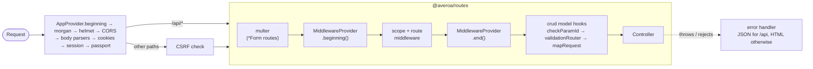

<p align="center">
  
</p>

<h1 align="center">AveroaJS</h1>

<p align="center">
  <b>Laravel-like structure for Express.</b><br>
  Controllers, models, migrations, generators and secure defaults for Express 5, so you can start on features instead of setup.
</p>

<p align="center">
  <a href="https://github.com/budiherma1/averoajs"></a>
  <a href="#license"></a>
  = 18.17">
  
  
</p>

<p align="center">
  <a href="#-quickstart">Quickstart</a> ·
  <a href="#-routing">Routing</a> ·
  <a href="#-models--crud">Models & CRUD</a> ·
  <a href="#-query-filtering-cheat-sheet">Filtering</a> ·
  <a href="#-authentication">Auth</a> ·
  <a href="#-cli-generators">CLI</a> ·
  <a href="#-upgrading-from-1x">Upgrading from 1.x</a>
</p>

---

AveroaJS is a boilerplate for building REST APIs and server-rendered apps on **Express 5**, **Knex 3** and
**Objection 3**. It gives you a Laravel-style project layout, one-command CRUD scaffolding, a query-string filter
language, JWT and session auth, and security middleware that is already configured.

> **Version 2** needs **Node.js 18.17 or newer** and is **ESM only**. Coming from 1.x? Read
> [Upgrading from 1.x](#-upgrading-from-1x).

## ✨ Why AveroaJS

| | |
| --- | --- |
| 🧭 **Laravel-style layout**<br>Controllers, Models, Middleware, Providers, Repositories, Helpers, Jobs and Strategies each have their own folder under `app/`. | ⚡ **REST CRUD from one command**<br>`node averoa make:crud teachers` generates the model, migration, seeder, controller and routes. |
| 🔎 **Filtering through the query string**<br>13 operators plus pagination, sorting, `$select` and `$relations`, all checked against the model's columns. | 🛡️ **Secure defaults**<br>Helmet CSP, CSRF on web routes, `httpOnly` session cookies, a CORS whitelist, upload limits and scrypt password hashes. |
| 🔑 **Auth included**<br>JWT login for the API (`/api/auth/login`) and a passport-local session strategy for server-rendered pages. | 🗄️ **Your choice of database**<br>MySQL (`mysql2`, the default), PostgreSQL (`pg`) or SQLite (`better-sqlite3`, `sqlite3`). |
| 📬 **Mail and queues**<br>Nodemailer with Edge templates, and RabbitMQ queues with a mail worker that retries failed sends. | 🧪 **Tests that need no setup**<br>`node --test` boots the real app on in-memory SQLite. No MySQL server needed. |

## 🚀 Quickstart

```bash
git clone https://github.com/budiherma1/averoajs.git
cd averoajs
cp .env.example .env
npm install
```

The app refuses to start without `TOKEN_SECRET`. Generate a secret and put it in `TOKEN_SECRET` (and a second one in
`SESSION_SECRET`) in `.env`:

```bash
npm run generate:token     # or: openssl rand -hex 64
```

Choose a database. **MySQL** is the default: fill in `DB_HOST`, `DB_PORT`, `DB_USER`, `DB_PASS` and `DB_NAME`.
**No database server?** Use SQLite instead:

```dotenv
DB_CLIENT=better-sqlite3
DB_NAME=database/dev.sqlite
```

(`better-sqlite3` is already a devDependency. To use SQLite in production, add it to your dependencies with
`npm i better-sqlite3`.)

Create the tables, load the demo data and start the dev server:

```bash
npm run migrate:up
npm run seed:run
npm run dev
```

Open <http://localhost:8888> to see the welcome view, or call the API:

```bash
curl http://localhost:8888/api
# -> {"name":"Averoa","version":"2.0.0"}
```

### What the boilerplate includes

| Method | Path | Handler |
| --- | --- | --- |
| `GET` | `/` | `SampleController@sampleMethodView` (Edge view `welcome`) |
| `GET` | `/users` | `SampleController@sampleMethodModel` (Edge view `users`) |
| `GET` | `/teacher` | `TeacherController@index` (Edge view `teacher`) |
| `GET` | `/api` | `SampleController@sampleMethod` |
| `POST` | `/api/users` | `SampleController@sampleMethodModelPost` (validates with `Users.validation()`) |
| `POST` | `/api/auth/login` | `AuthController@login` |
| `GET` | `/api/auth/me` | `AuthController@me`, behind `AuthMiddleware` |
| `GET` `POST` `PUT` `DELETE` | `/api/teachers`, `/api/teachers/:id` | `TeacherController` CRUD (`router.crud('Teacher', ...)`) |
| `GET` | `/api/v2/teachers` | `TeacherController@findAll` (nested `prefix()` example) |
| `GET` | `/api/v2/test`, `/api/v2/test/otherprefix` | `SampleController@sampleMethodView` |

## 📁 Project structure

```text
averoajs/
├── app/
│   ├── Console/           # CLI for this project (coming soon)
│   │   └── Command/
│   ├── Controllers/       # request handlers: 'TeacherController@findAll'
│   ├── Helpers/           # your helpers/utils            -> import from '#helpers'
│   ├── Jobs/              # jobs and workers              -> '#jobs'
│   ├── Middleware/        # route middleware: ['AuthMiddleware']
│   ├── Models/            # Objection models + column definitions -> '#models'
│   ├── Providers/         # App, Middleware, Upload and View providers -> '#providers'
│   ├── Repositories/      # long or complicated queries   -> '#repositories'
│   └── Strategies/        # passport strategies           -> '#strategies'
├── config/                # database.js, fetch.js (axios), mail.js, queue.js
├── database/
│   ├── migrations/
│   └── seeds/
├── public/                # static files served at /
├── resources/
│   ├── assets/            # js/components, sass (coming soon)
│   ├── lang/              # en, id (coming soon)
│   └── views/             # Edge templates
├── routes/
│   ├── api.js             # mounted at /api
│   ├── web.js             # mounted at /
│   └── v2/                # nested route files used by api.js
├── scripts/
│   └── link-local.mjs     # test against local checkouts of the framework packages
├── storages/
│   ├── logs/              # averoa.log (Log util), access.log, error.log
│   └── upload/            # uploaded files, served at /upload
├── tests/                 # node --test
├── .env.example
├── averoa.js              # CLI entry: node averoa make:...
└── server.js              # app entry: awaits start() from @averoa/core
```

<details>
<summary>More about each folder</summary>

- **`app/Console`** is reserved for project CLI commands (coming soon).
- **`app/Controllers`**: Express 5 forwards errors thrown by `async` controller methods to the error handler, so you
  don't need `try/catch` just to keep a request from hanging. `req.query` is read-only in Express 5: copy it
  (`const q = { ...req.query }`) instead of changing it.
- **`app/Jobs`**: `EmailSubscriberJob` starts the mail worker of `@averoa/utilities` (`startMailWorker`), which delivers
  mails queued with `Mail...queue()`. `GenerateAppTokenJob` prints a random secret (`npm run generate:token`).
- **`config`** sets up the database, fetch (axios), mail and queue.
- **`database`** holds the migration and seeder files.
- **`public`** holds files anyone can access, such as images, CSS and JS.
- **`resources/views`** holds the view templates. AveroaJS uses [Edge](https://edgejs.dev/docs/introduction) as the
  template engine. `assets` and `lang` are coming soon.
- **`storages/logs`** holds the log of the `Log` util plus the access and error logs. **`storages/upload`** holds
  files uploaded to this server.

</details>

## 🔄 Request lifecycle



Requests that match no route fall through to static files (`public/`, `/upload`), then `AppProvider.end(app)`, then the
404 handler. See [`@averoa/core`](https://github.com/budiherma1/AveroaCore) for the exact order.

## 🧭 Routing

`routes/web.js` is mounted at `/` (with CSRF) and `routes/api.js` at `/api` (without CSRF). Handlers are
`'Controller@method'` strings that are resolved from `app/Controllers` when the app starts, so a typo fails at boot
and not at request time.

```js
import Router from '@averoa/routes';

const router = Router();

router.get('/', 'SampleController@sampleMethodView');
router.get('/users', 'SampleController@sampleMethodModel');

router.middleware(['AuthMiddleware'], () => {
  router.get('/profile', 'ProfileController@show');
});

router.prefix('/v2', () => {
  router.get('/teachers', 'TeacherController@findAll');
});

export default router;
```

| Method | What it does |
| --- | --- |
| `get` / `post` / `put` / `patch` / `delete(uri, handler, middleware?)` | `handler` is `'Controller@method'` or a function |
| `postForm` / `putForm` / `patchForm(...)` | same, with multipart parsing (`req.files`) |
| `match(verbs, ...)`, `any(...)`, `all(...)` | several verbs at once |
| `middleware(names, cb)` · `prefix(prefix, cb)` · `group({ middleware, prefix }, cb)` | scopes for every route declared in `cb` |
| `crud(Model, prefix, cb)` | prefix plus the model's validation and 404 hooks (see below) |

For the full API, see [`@averoa/routes`](https://github.com/budiherma1/AveroaRoute).

## 🧱 Models & CRUD

### Generate a REST resource with one command

```bash
node averoa make:crud sample_db_table,another_db_table,db_table --init
```

For each table this writes the model, migration, seeder and controller, then registers the routes. `--init` writes a
fresh `routes/api.js`, for the first run. To add more tables later, leave out `--init` and the routes are appended to
the existing `routes/api.js`. Existing files are not overwritten unless you add `--force`.

> [!NOTE]
> The boilerplate already ships a `routes/api.js` (with the auth routes), so you usually want the command
> **without** `--init`. With `--init` it refuses to run unless you add `--force`, which replaces that file.

Edit the generated model, then run `npm run migrate:up`, `npm run seed:run` and `npm run dev`.

The generated routes look like this:

```js
router.crud('Users', 'users', () => {
  router.get('/', 'UsersController@findAll');
  router.get('/:id', 'UsersController@findOne');
  router.post('/', 'UsersController@create');
  router.put('/:id', 'UsersController@update');
  router.delete('/:id', 'UsersController@delete');
});
```

Inside `crud()`, the model's hooks run before your controller:

| Verb | Hooks | Result |
| --- | --- | --- |
| `POST`, `PUT`, `PATCH` | `checkParamId → validationRouter → mapRequest` | `404 { status: false, message }` for an unknown or soft-deleted `:id`; `422 { status: false, data: { column, message } }` when validation fails |
| `GET`, `DELETE` | `checkParamId → mapRequest` | `404` for an unknown or soft-deleted `:id` |

- `delete` is a **soft delete** (it sets `deleted_at`) unless the model sets `static timestamp = false`. Soft-deleted
  rows are excluded from every read.
- Columns listed in the model's `static hidden` are never returned.
- The sample `TeacherController` answers `201` on create and `400` when `Crud` reports a failure.

### Define a model

```js
import { Model } from '@averoa/utilities';

class Users extends Model {
  static tableName = 'users';
  static timestamp = true;        // created_/updated_/deleted_ columns, soft delete
  static hidden = ['password'];   // never serialized, never selectable through $select
  // static allowGraph = '[roles]'; // relations clients may request with $relations

  static column = {
    email: {
      migration: (m) => m.table.string(m.column, 50).nullable(),
      seed: (f) => f.internet.email(), // faker 9 API (f.person.*, f.number.int, ...)
      flag: { required: true, unique: true },
      validation: [{ run: (v) => v.validator.isEmail(String(v.value)), msg: 'email format required' }],
    },
  };
}
```

One `column` definition drives the migration (`Model.migrationUp`), the seeder (`Model.seeder`) and request
validation (`validationRouter`). `validation[].run` receives `{ validator, value }`, where `validator` is the
[validator](https://www.npmjs.com/package/validator) package.

| Column flag | Default | Meaning |
| --- | --- | --- |
| `required` | `true` | must be present (on create; must not be emptied on update) |
| `unique` | | checked against rows that are not soft-deleted |
| `upload` | | file field for `*Form` routes; stored through `UploadProvider` |
| `search` | `true` | used by `Model.search()` |
| `fillable` | | allow writing the primary key from the request |

| Static property | Effect |
| --- | --- |
| `timestamp` | `false` turns off the `created_*` / `updated_*` / `deleted_*` columns and soft delete |
| `hidden` | stripped from JSON; not usable in `$select`, filters or `orderBy` |
| `allowGraph` | relations clients may load with `$relations` (default: the model's own relations, depth 1; `false` = none) |
| `allowWithTrashed` | allow `?$withTrashed=1` to include soft-deleted rows |

### Query the database

AveroaJS uses [ObjectionJS](https://vincit.github.io/objection.js/guide/relations.html) as the ORM and
[Knex](http://knexjs.org/guide/query-builder.html) as the query builder.

```js
import { Users } from '#models';
import { DB } from '@averoa/utilities';

class HomeController {
  async getUsers(req, res) {
    const users = await Users.query();                          // Objection model
    const emails = await DB.select('id', 'email').from('users'); // Knex query builder
    res.send({ users, emails });
  }
}
```

Put long or complicated queries in `app/Repositories` (`node averoa make:repository UsersRepository`) and import them
with `import { UsersRepository } from '#repositories';`.

## 🔎 Query filtering cheat-sheet

Every `findAll` CRUD endpoint (for example `GET /api/teachers`) accepts these query parameters. Unknown columns or
operators, hidden columns and invalid values are rejected with `{ status: false, message }`. They are never silently
ignored.

| Parameter | SQL | Example |
| --- | --- | --- |
| `col=v` | `= v` | `/api/teachers?type=2` |
| `col:eq=v` | `=` | `/api/teachers?user_id:eq=4` |
| `col:neq=v` | `!=` | `/api/teachers?type:neq=3` |
| `col:lt=v` | `<` | `/api/teachers?saldo:lt=500000` |
| `col:lte=v` | `<=` | `/api/teachers?saldo:lte=500000` |
| `col:gt=v` | `>` | `/api/teachers?saldo:gt=500000` |
| `col:gte=v` | `>=` | `/api/teachers?saldo:gte=500000` |
| `col:like=v` | `like` (`like binary`, case-sensitive, on MySQL) | `/api/teachers?teacher_name:like=%25Ada%25` |
| `col:ilike=v` | `ilike` on PostgreSQL, `like` elsewhere | `/api/teachers?teacher_name:ilike=%25ada%25` |
| `col:in=a,b` | `in (a, b)` | `/api/teachers?id:in=1,2,3,4` |
| `col:btwn=a,b` | `between a and b` | `/api/teachers?saldo:btwn=200000,500000` |
| `col:isNull=` | `is null` | `/api/teachers?address:isNull=true` |
| `col:notNull=` | `is not null` | `/api/teachers?address:notNull=true` |
| `a\|b:search=words` | any word, `%word%`, in any listed column | `/api/teachers?teacher_name\|address:search=ada%20london` |
| `a\|b\|c:op=v` | the same operator on several columns, joined with `OR` | `/api/teachers?saldo\|type:lt=44` |
| `orderBy=col` / `orderByDesc=col` | sort ascending / descending | `/api/teachers?orderByDesc=created_at` |
| `groupBy=col` | `group by` | `/api/teachers?groupBy=type` |
| `limit=n` | page size (default `10`; `0` = all, up to `maxLimit` 1000) | `/api/teachers?limit=20` |
| `page=n` | page number, starting at `1` | `/api/teachers?limit=20&page=2` |
| `$select=a,b` | pick columns (hidden ones are refused) | `/api/teachers?$select=id,teacher_name` |
| `$relations=[...]` | load relations allowed by `static allowGraph` | `/api/teachers?$relations=[rooms]` |
| `$relations-type=join` | join the relations, so you can filter on `relation.col` | `/api/teachers?$relations=[rooms]&$relations-type=join&rooms.room_name=Room%20A` |
| `$withTrashed=1` | include soft-deleted rows; refused unless the model sets `static allowWithTrashed = true` | `/api/teachers?$withTrashed=1` |

> In a URL, `%` must be sent as `%25`: `teacher_name:like=%25Ada%25` means `like '%Ada%'`. `orderBy`, `orderByDesc` and
> `groupBy` accept only the model's own columns.

The response is paginated:

```json
{
  "status": true,
  "metadata": {
    "item_total": 42, "per_page": 10, "page_total": 5,
    "current_page": 1, "has_next_page": true, "has_prev_page": false
  },
  "data": [ { "id": 1, "teacher_name": "Ada" } ]
}
```

## 🔑 Authentication

### JWT for the API

```bash
# the seeder creates demo@averoa.test / password (development data only)
curl -X POST http://localhost:8888/api/auth/login \
  -H 'content-type: application/json' \
  -d '{"email":"demo@averoa.test","password":"password"}'
# -> { "status": true, "data": { "token": "eyJ...", "type": "Bearer", "expires_in": "1h" } }

curl http://localhost:8888/api/auth/me -H 'authorization: Bearer eyJ...'
# -> { "status": true, "data": { "id": 11, "email": "demo@averoa.test", ... } }   (401 without a valid token)
```

How it fits together:

| File | Role |
| --- | --- |
| `routes/api.js` | `POST /auth/login` and, inside `router.middleware(['AuthMiddleware'], ...)`, `GET /auth/me` |
| `app/Controllers/AuthController.js` | checks the credentials and signs `{ id }` with `TOKEN_SECRET` (HS256); missing fields answer `422`, wrong credentials `401` |
| `app/Middleware/AuthMiddleware.js` → `app/Strategies/JwtStrategy.js` | verifies the bearer token, sets `req.user` and calls `next()`, or answers `401 { status: false, message: 'Unauthorized' }` |
| `app/Repositories/UserRepository.js` | user lookup (soft-deleted users can't log in) and password check |
| `app/Helpers/PasswordHelper.js` | scrypt hashing with `node:crypto` (`hash`, `hashSync`, `verify`) |
| `app/Models/Users.js` | hashes `password` on insert/update and hides `password` and `otp` from every response (`static hidden`) |

Protect any route by putting it inside `router.middleware(['AuthMiddleware'], () => { ... })`.

### Sessions for server-rendered pages

`app/Strategies/LocalStrategy.js` is the session/cookie variant. It is a passport-local strategy that reads `email`
and `password`, checks the real password and stores only the user id in the session. `LoginMiddleware` runs it.
Attach that middleware to the web route that handles your login form. The boilerplate does not mount it on any route.

### Writing a strategy

`node averoa make:strategy JwtStrategy` creates a strategy in `app/Strategies`. A strategy has 2 methods. `config()`
registers it with passport and is called once at startup. `authenticate(req, res, next)` is used by a middleware.
Note that `passport.authenticate(...)` returns a middleware, which you must call with `(req, res, next)`:

```js
authenticate(req, res, next) {
  passport.authenticate('jwt', { session: false }, (err, user) => {
    if (err) return next(err);
    if (!user) return res.status(401).json({ status: false, message: 'Unauthorized' });
    req.user = user;
    return next();
  })(req, res, next);
}
```

```js
import { JwtStrategy } from '#strategies';

class AuthMiddleware {
  handle(req, res, next) {
    JwtStrategy.authenticate(req, res, next);
  }
}

export default new AuthMiddleware();
```

## 🔐 Security defaults

These are on out of the box, from [`@averoa/core`](https://github.com/budiherma1/AveroaCore) and the boilerplate:

| Area | Default |
| --- | --- |
| **Headers** | helmet 8 with a Content-Security-Policy that allows local assets (`public/`), inline styles and Google Fonts. Scripts must be local files (no inline `<script>`, no CDN) unless you relax the policy in `AppProvider.helmet(defaults)` |
| **CSRF** | on for every web route (outside `/api`) unless `CSRF_ENABLED=false`. See below |
| **Sessions** | `httpOnly`, `sameSite: 'lax'`, `secure` in production. `SESSION_SECRET` is required in production |
| **CORS** | `CORS_WHITELIST` (`https://*.example.com` matches subdomains only). When it is empty, production allows every origin without credentials. Disallowed origins get `403` |
| **Bodies** | JSON and urlencoded bodies are limited to `BODY_LIMIT` (`1mb`) |
| **Uploads** | `UploadImageMiddleware` accepts one `image` field (jpeg, png, gif or webp, at most `UPLOAD_MAX_FILE_SIZE` bytes) and otherwise answers `422` or `413`. `UploadProvider` sanitizes names and routes and never writes or deletes outside `storages/upload` |
| **Passwords** | scrypt hashes. Logins with an unknown email are checked against a dummy hash, so they take the same time |
| **Errors** | `{ status: false, message }` JSON for `/api`. Stack traces appear only outside production |

### CSRF

GET, HEAD and OPTIONS requests pass. Every other method must send the session's token:

```html
<form method="post" action="/profile">
  <input type="hidden" name="_csrf" value="{{ csrfToken }}">
  ...
</form>
```

AJAX and multipart requests send it in the `x-csrf-token` header instead (`req.csrfToken()` returns it in a
controller). A missing or wrong token gets `403`. `/api` routes are not checked because they authenticate with tokens.

## 🧰 CLI generators

Run the generators with `node averoa <command>`. Names must be JavaScript identifiers. Add `--force` to overwrite an
existing file.

| Command | Creates | Import |
| --- | --- | --- |
| `node averoa make:controller NameController` | `app/Controllers/NameController.js` | used as `'NameController@method'` in routes |
| `node averoa make:middleware TestMiddleware` | `app/Middleware/TestMiddleware.js` | used as `['TestMiddleware']` in routes |
| `node averoa make:model Users [--table users]` | `app/Models/Users.js` + entry in `app/Models/index.js` | `import { Users } from '#models'` |
| `node averoa make:helper YourHelper` | `app/Helpers/YourHelper.js` + index entry | `import { YourHelper } from '#helpers'` |
| `node averoa make:job SampleJob` | `app/Jobs/SampleJob.js` + index entry | `import { SampleJob } from '#jobs'` |
| `node averoa make:repository UsersRepository` | `app/Repositories/UsersRepository.js` + index entry | `import { UsersRepository } from '#repositories'` |
| `node averoa make:strategy JwtStrategy` | `app/Strategies/JwtStrategy.js` + index entry | `import { JwtStrategy } from '#strategies'` |
| `node averoa make:crud table_a,table_b [--init]` | model, migration, seeder and controller per table, plus `crud()` routes in `routes/api.js` | see [Models & CRUD](#-models--crud) |

`make:model` keeps the class name as typed and uses the lower-cased name as the table unless you pass `--table`.
`make:crud` turns `user_categories` into the model `UserCategories` and the route prefix `user-categories`.

## 💾 Migrations & seeders

The knex CLI is installed with the project, so you don't need a global install. The scripts run it with `--cwd .` so
paths resolve from the project root.

| Script | What it does |
| --- | --- |
| `npm run migrate:make migration_name` | create a migration file |
| `npm run migrate:up` | run the pending migrations |
| `npm run migrate:down` | roll back the last batch |
| `npm run migrate:list` | list completed and pending migrations |
| `npm run seed:make seeder_name` | create a seeder file |
| `npm run seed:run` | run the seeders |

Don't edit a migration that already ran somewhere. Add a new one instead (see
`database/migrations/20261116000000_add_password_to_users.js`).

## 🔧 Configuration

All settings are environment variables. Copy `.env.example` to `.env` to start.

<details open>
<summary><b>Environment variables</b></summary>

| Variable | Default | Description |
| --- | --- | --- |
| `NODE_ENV` | `development` | `production` turns on view caching |
| `APP_HOST`, `APP_PORT` | `http://localhost`, `8888` | where the server listens (`@averoa/core` falls back to port `3000` when `APP_PORT` is unset) |
| `CORS_WHITELIST` | | comma separated list of allowed origins; when empty, production allows every origin without credentials |
| `TOKEN_SECRET` | **required** | secret used to sign JWTs |
| `TOKEN_EXPIRES_IN` | `1h` | JWT lifetime (`60`, `2h`, `7d`) |
| `SESSION_SECRET` | random per boot in development | secret for the session cookie, **required in production**; a comma separated list rotates secrets (first signs, all verify) |
| `CSRF_ENABLED` | `true` | CSRF protection for web (non `/api`) routes, see [CSRF](#csrf) |
| `BODY_LIMIT` | `1mb` | max JSON / urlencoded body size |
| `LOG_LEVEL` | `info` | `error`, `warn`, `info`, `http`, `verbose`, `debug`, `silly` |
| `UPLOAD_MAX_FILE_SIZE` | `2097152` | max upload size in bytes (`UploadImageMiddleware`) |
| `TRUST_PROXY` | `false` | Express `trust proxy` setting, for apps behind a reverse proxy |
| `SHUTDOWN_TIMEOUT` | `10000` | max ms for the graceful shutdown on SIGTERM / SIGINT |
| `AVEROA_ROOT` | nearest `package.json` above the working directory | application root, only needed when the process starts elsewhere |
| `DB_CLIENT` | `mysql2` | `mysql2`, `pg`, `better-sqlite3` or `sqlite3` (`mysql` is mapped to `mysql2`) |
| `DB_HOST`, `DB_PORT`, `DB_USER`, `DB_PASS`, `DB_NAME` | | connection; for SQLite `DB_NAME` is the file (default `:memory:`) |
| `RABBITMQ_SERVER` | `amqp://localhost` | used by `Queue` and `EmailSubscriberJob` |
| `MAIL_QUEUE` | `mail` | default queue of `Mail...queue()` and `EmailSubscriberJob` |
| `MAIL_HOST`, `MAIL_PORT`, `MAIL_USERNAME`, `MAIL_PASSWORD`, `MAIL_ENCRYPTION` | | SMTP (`MAIL_ENCRYPTION=ssl` for port 465) |

</details>

The `config/` folder holds `database.js` (Knex), `fetch.js` (axios), `mail.js` (nodemailer) and `queue.js` (AMQP).

<details>
<summary><b>Importing app code with <code>#</code> subpath imports</b></summary>

`package.json` defines [subpath imports](https://nodejs.org/api/packages.html#subpath-imports), so app code never
needs `../../` paths:

| Import | Resolves to |
| --- | --- |
| `#models` | `app/Models/index.js` |
| `#providers` | `app/Providers/index.js` |
| `#repositories` | `app/Repositories/index.js` |
| `#helpers` | `app/Helpers/index.js` |
| `#jobs` | `app/Jobs/index.js` |
| `#strategies` | `app/Strategies/index.js` |
| `#app/*` | `app/*` (with extension, e.g. `#app/Strategies/JwtStrategy.js`) |

```js
import { Users } from '#models';
import { UploadProvider } from '#providers';
```

</details>

<details>
<summary><b>Providers</b>: hook into the app, global middleware, uploads, view globals</summary>

#### AppProvider

Add your own modules here. For example, to serve Swagger UI (after `npm i swagger-ui-express`):

```js
import swaggerUi from 'swagger-ui-express';
import swaggerDocument from './swagger.json' with { type: 'json' };

class AppProvider {
  beginning(app) {
    app.use('/api-docs', swaggerUi.serve, swaggerUi.setup(swaggerDocument));
  }
}
```

Every method is optional:

- `beginning(app)` / `end(app)`: Express setup before / after the framework's own. `beginning` runs before every other
  module is set up. `end` runs after them.
- `helmet(defaults)`: return the helmet options (e.g. a relaxed CSP), or `false` to disable helmet
- `session()`: extra express-session options (e.g. a store)
- `server(server)`: called after the HTTP server has started
- `shutdown()`: called on SIGTERM / SIGINT before the DB and queue connections close

#### MiddlewareProvider

Sets global middleware for all routes. For example, to make the image upload middleware global:

```js
import UploadImageMiddleware from '../Middleware/UploadImageMiddleware.js';

class MiddlewareProvider {
  beginning() {
    return [
      UploadImageMiddleware,
    ];
  }
}
```

Like AppProvider, it has 2 methods, `beginning` and `end`, and both may return nothing. Create route middleware with
`node averoa make:middleware TestMiddleware`.

#### UploadProvider

Stores uploaded files under `storages/upload/<route>/` with a random, sanitized name and returns the stored relative
name. It never writes or deletes outside `storages/upload`.

#### ViewProvider

Registers global variables for every view. Return them from the `global` method:

```js
class ViewProvider {
  // Global variable for view
  global() {
    return {
      testVariable: 'this is global variable',
      sayHello: (value = '') => `Hai ${value}, Greeting from ViewProvider`,
    };
  }
}
```

For now `global` is its only method.

</details>

<details>
<summary><b>Utilities</b>: DB, Fetch, Log, Mail, Queue, Validator</summary>

All of these come from [`@averoa/utilities`](https://github.com/budiherma1/AveroaUtilities).

#### DB (Knex), configured in `config/database.js`

```js
import { DB } from '@averoa/utilities';

class SampleClass {
  async sample(req, res) {
    const users = await DB.select('id', 'email').from('users');
    res.send(users);
  }
}

export default new SampleClass();
```

#### Fetch (axios), configured in `config/fetch.js`

```js
import { Fetch } from '@averoa/utilities';

class SampleClass {
  async sample(req, res) {
    const data = await Fetch.get('/user/12345');
    res.send(data);
  }
}

export default new SampleClass();
```

#### Log (winston), written to `storages/logs/averoa.log`

```js
import { Log } from '@averoa/utilities';

class SampleClass {
  sample(req, res) {
    Log.info('test Log info');
    Log.warn('test Log warn');
    res.send('hello');
  }
}

export default new SampleClass();
```

Log severity: `error: 0`, `warn: 1`, `info: 2`, `http: 3`, `verbose: 4`, `debug: 5`, `silly: 6`.

#### Mail (nodemailer), configured in `config/mail.js`

```js
import { Mail } from '@averoa/utilities';

class SampleClass {
  async sample(req, res) {
    await Mail.init()
      .from('info@averoa.com')
      .to('customer@mail.com')
      .subject('Welcome to Averoa')
      .html('email', { name: 'Averoa' }) // use template view
      // .html('<h1>Hellow</h1>') // use plain html
      // .queue('Email Channel') // enable this if this email will be sent to queue
      .text('text of this email')
      .send();

    res.send('done');
  }
}

export default new SampleClass();
```

#### Queue (AMQP), configured in `config/queue.js`

```js
import { Queue } from '@averoa/utilities';

class SampleClass {
  async sample(req, res) {
    await Queue('test channel', { name: 'Averoa', version: '2.0.0' });
    res.send('done');
  }
}

export default new SampleClass();
```

#### Validator

This is the [validator](https://www.npmjs.com/package/validator) package. See its docs for the full API.

```js
import { Validator } from '@averoa/utilities';
```

</details>

## 🧪 Testing

Tests use the built-in Node.js test runner (`node --test`), with no extra framework:

```bash
npm test
```

`tests/app.test.js` boots the real app with `createApp()` from `@averoa/core` on an in-memory SQLite database
(`better-sqlite3`), runs the migrations and seeders, and checks the JWT flow and the Teacher CRUD over HTTP.
No MySQL is needed. Running the suite needs **Node.js 22+** (test file glob, `better-sqlite3` 12).

To run the tests against local checkouts of the framework packages (`../dependencies/AveroaUtilities`,
`AveroaRoute`, `AveroaCore`) instead of the npm versions:

```bash
npm run link:local     # packs ../dependencies/*; re-run after every `npm install`
npm test
```

Lint with `npm run lint` (ESLint, airbnb-base).

## 🆙 Upgrading from 1.x

<details>
<summary><b>Breaking changes in 2.0.0</b> (click to expand)</summary>

- **Node.js 18.17+**, ESM only. Express 5, Knex 3, multer 2, passport 0.7, jsonwebtoken 9.
- **Framework packages**: `@averoa/core` ^2, `@averoa/utilities` ^2, `@averoa/routes` ^3. The one-line re-export
  packages `@averoa/models`, `@averoa/providers`, `@averoa/repositories`, `@averoa/helpers` and `@averoa/jobs` are
  deprecated and removed from the dependencies: replace their imports with the `#models`, `#providers`,
  `#repositories`, `#helpers` and `#jobs` subpath imports (add the `imports` block of this `package.json` to yours).
- **Removed dependencies** (unused by the app or now inside `@averoa/core` / `@averoa/utilities`): `helmet`,
  `express-handlebars`, `mysql`, `passport-google-oauth`, `passport-google-oauth20`, `passport-http-bearer`, `glob`,
  `crypto`, `csurf`, `moment`, `axios`, `chalk`, `commander`, `cookie-parser`, `cors`, `express-session`, `morgan`,
  `validator`, `winston`, `amqplib`, `nodemailer`, `jest`. Install any of them again if your own code imports it.
- **Database**: `DB_CLIENT` defaults to `mysql2` (`mysql` is mapped to it). SQLite is supported (`better-sqlite3`,
  `sqlite3`). Run `npm run migrate:up` to add the new `users.password` column.
- **Auth**: `TOKEN_SECRET` is required at startup. `AuthMiddleware` now really authenticates (in 1.x every route
  behind it hung forever) and answers `401` JSON; `req.user` is the `Users` row. `LocalStrategy` checks the real
  password (1.x accepted any credentials); sessions store only the user id.
- **Users model**: per-column validation (1.x required every column to be an email), `password` hashed with scrypt
  and hidden together with `otp`.
- **Validation / missing ids** answer `422` / `404` instead of `200` with `status: false`.
- **Express 5**: `req.query` is read-only; route patterns follow path-to-regexp v8 (no `*` wildcards; use `*name`).
- **Uploads**: `UploadImageMiddleware` keeps files in memory, accepts only images up to `UPLOAD_MAX_FILE_SIZE`;
  `UploadProvider` sanitizes names and routes.
- **Tests**: jest was replaced by `node --test`.
- **Seeders** get faker 9 (`@faker-js/faker` is now a devDependency of the app): use `f.person.firstName()`,
  `f.location.streetAddress()`, `f.number.int({ min, max })` instead of `f.name.*`, `f.address.*`,
  `f.datatype.number()`.
- **Mail queue**: `EmailSubscriberJob` uses `startMailWorker` from `@averoa/utilities`; the default queue is
  `MAIL_QUEUE` or `mail`.
- **CSRF** is on by default for web routes: add `<input type="hidden" name="_csrf" value="{{ csrfToken }}">` to
  every non-GET form (or set `CSRF_ENABLED=false`). **CSP** allows only local scripts.
- **`SESSION_SECRET`** is required when `NODE_ENV=production`.
- **CLI**: `make:crud -init` is now `--init`; `--force` is needed to overwrite files.
- **`server.js`** awaits `start()`, which resolves to `{ app, server }`; `createApp()` builds the app without
  listening (used by the tests).
- **Mail**: `secure` follows `MAIL_ENCRYPTION=ssl` / port 465 instead of `NODE_ENV=production`;
  `MAIL_USERNAME=null` is no longer needed (leave it empty).
- New `.env` variables: `TOKEN_EXPIRES_IN`, `SESSION_SECRET`, `CSRF_ENABLED`, `BODY_LIMIT`, `LOG_LEVEL`,
  `UPLOAD_MAX_FILE_SIZE`, `TRUST_PROXY`, `SHUTDOWN_TIMEOUT`, `AVEROA_ROOT`, `MAIL_QUEUE`.

</details>

Each framework package lists its own breaking changes in its `CHANGELOG.md`:
[@averoa/core](https://github.com/budiherma1/AveroaCore) ·
[@averoa/utilities](https://github.com/budiherma1/AveroaUtilities) ·
[@averoa/routes](https://github.com/budiherma1/AveroaRoute).

## 🧩 Ecosystem

| Package | Version | What it does | Links |
| --- | --- | --- | --- |
| **averoajs** | 2.0.0 | this boilerplate | [repo](https://github.com/budiherma1/averoajs) |
| **@averoa/core** | 2.0.0 | builds the Express 5 app (security headers, sessions, CSRF, CORS, views, routes, errors) and the `averoa` CLI | [repo](https://github.com/budiherma1/AveroaCore) · [npm](https://www.npmjs.com/package/@averoa/core) |
| **@averoa/utilities** | 2.0.0 | Model, Crud, FilterSearch, DB, Mail, Queue, View, Log, Fetch, Validator | [repo](https://github.com/budiherma1/AveroaUtilities) · [npm](https://www.npmjs.com/package/@averoa/utilities) |
| **@averoa/routes** | 3.0.0 | Laravel-style router: `'Controller@method'`, groups, prefixes, `crud()` hooks | [repo](https://github.com/budiherma1/AveroaRoute) · [npm](https://www.npmjs.com/package/@averoa/routes) |
| @averoa/models · providers · repositories · helpers · jobs | 1.0.2 | ⚠️ deprecated in 2.0; use the `#models`, `#providers`, `#repositories`, `#helpers`, `#jobs` subpath imports | [models](https://github.com/budiherma1/AveroaModels) · [providers](https://github.com/budiherma1/AveroaProviders) · [repositories](https://github.com/budiherma1/AveroaRepositories) · [helpers](https://github.com/budiherma1/AveroaHelpers) · [jobs](https://github.com/budiherma1/AveroaJobs) |

## 🤝 Contributing

Issues and pull requests are welcome at [github.com/budiherma1/averoajs](https://github.com/budiherma1/averoajs).
Before you open a pull request, run:

```bash
npm run lint
npm test
```

Changes to the framework itself (app bootstrap, router, models, filters) go to the package repositories listed in the
[Ecosystem](#-ecosystem) table.

## Author

- [@budiherma1](https://www.github.com/budiherma1)

## License

[MIT](https://choosealicense.com/licenses/mit/)
